# Event Streaming Pipeline with Amazon MSK Serverless: From Kafka to an S3 Data Lake

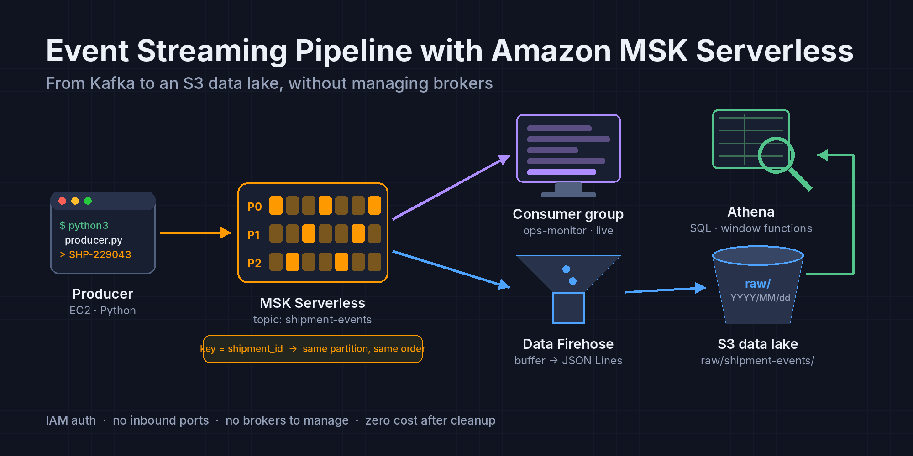

An end to end event streaming project for a shipment tracking scenario, built entirely on the **AWS Console**: an IAM protected Kafka cluster on **Amazon MSK Serverless** without managing brokers, shipment events produced by a Python producer on EC2 with `shipment_id` as the key and written to a topic, the same stream watched live by a consumer group and archived to S3 with **Amazon Data Firehose** without setting up Kafka Connect, and finally **Athena** queries for the latest status and delivery time of each shipment; closed with a cleanup that leaves zero cost behind.

## What This Project Demonstrates

- Setting up a Kafka cluster with **MSK Serverless** without managing brokers, capacity or storage
- Managing Kafka access with **IAM access control** instead of usernames, passwords or certificates; limiting `kafka-cluster` actions at the cluster, topic and consumer group level
- Opening only port `9098` between the client and the cluster with a security group reference; connecting to the client machine with **Session Manager** without opening the SSH port
- **Ordering guarantee** with a partition key: events belonging to the same `shipment_id` always land in the same partition
- **Consumer group** and offset logic: independent consumers reading the same data at their own pace
- Serverless delivery from a topic to S3 without writing code, using the MSK source of **Amazon Data Firehose**
- Answering business questions by querying the JSON events accumulated in S3 with **Athena**
- A **cleanup** performed in dependency order that puts the hourly billed cluster first

## Architecture

A Python producer on EC2 writes synthetic shipment events to the `shipment-events` topic (3 partitions) on the MSK Serverless cluster, using `shipment_id` as the key. Two independent consumers read the same topic: the `ops-monitor` consumer group, representing the operations team, watches the events live; Amazon Data Firehose buffers the records it reads from the topic and writes them as files under the `raw/` prefix in S3. Athena queries the latest status and the delivery times of the shipments through an external table defined on this prefix. Traffic between the client and the cluster never leaves the VPC and passes only through port `9098`, authenticated with IAM.

## Services Used

`Amazon MSK Serverless` · `Amazon Data Firehose` · `Amazon S3` · `Amazon Athena` · `AWS Glue Data Catalog` · `Amazon EC2` · `AWS Systems Manager (Session Manager)` · `Amazon VPC` · `AWS IAM` · `Apache Kafka`

## Prerequisites

- An AWS account (an MSK Serverless cluster is billed hourly even when idle; if the project is finished in a single session and cleaned up, the total cost is in the range of a few dollars)
- Region: the guide uses `eu-central-1` (Frankfurt); any region works as long as it is used consistently
- No tooling is needed on the local machine: the Kafka CLI, Python and the AWS CLI are used on EC2 through Session Manager
- Familiarity with the concepts of topic, partition and offset helps but is not required; the concepts needed are explained in the relevant sections

## Problem (Solution Request)

A shipping company produces status events for every shipment throughout the day: shipment created, handed to the courier, at the transfer center, out for delivery, delivered. Today these events reach the analytics team through a database dump taken at night, and the operations team can only see the situation in the field the next day. There are two requests: an **event streaming** layer where events can be read independently by several teams the moment they are produced, and the same events accumulating permanently in a **data lake** for analysis. An additional constraint: the events of a shipment must be processed **in the order they were produced**, whichever consumer handles them; the "delivered" event must never appear before "out for delivery". There is nobody on the team to manage a cluster.

**Why writing the events straight to a database and querying it is not enough:** Every consumer constantly polling the same table wears out the database and makes the producer dependent on the consumers; adding a new consumer usually requires a change on the producer side. In Kafka the producer only writes to the topic and every consumer group keeps its own offset; adding a new team is as simple as opening a new consumer group, and past events can be read again for as long as the retention period lasts.

**Why not Kinesis Data Streams:** Kinesis solves the same problem and is more tightly integrated with AWS services; however, the company's existing applications are written with Kafka client libraries and Kafka tools. Because MSK offers the open source Kafka API as it is, they move without code changes; the Serverless option brings the "no servers to manage" advantage of Kinesis to the Kafka side.

**Why not self managed Kafka on EC2:** Brokers, the KRaft layer, disk growth, version upgrades and partition rebalancing remain the responsibility of the team, and there is nobody on the team to do that. In MSK Serverless the concept of a broker disappears entirely: capacity adjusts automatically to throughput, and the price is based on cluster time, partition count and data volume.

## Task List

1. VPC and security groups: default VPC verification, two security groups for the client and the cluster (a referenced rule on port `9098`)
2. IAM: instance role for the EC2 client (Session Manager + `kafka-cluster` permissions limited to the cluster, the topic and consumer groups)
3. Amazon MSK Serverless cluster (IAM access control) and the cluster policy for Firehose
4. EC2 client machine: Amazon Linux 2023, Session Manager connection, installing Java + the Kafka CLI + MSK IAM auth
5. Creating the topic and testing a producer and a consumer with the Kafka CLI
6. Python producer: synthetic shipment events (`shipment_id` key), reading with a consumer group, observing partitions and ordering
7. Amazon S3 bucket and Amazon Data Firehose: MSK source, S3 destination
8. Athena: external table, latest status and delivery time queries per shipment
9. Evaluating the architecture as a whole
10. Cleanup

## 1. Amazon VPC (Network Verification and Security Groups)

Amazon VPC is an isolated virtual network that belongs to you inside AWS: the IP address range, subnets, route tables and the internet gateway are parts of this network. The network model of MSK Serverless is decisive here: the brokers run in a separate environment managed by AWS and are not visible in your account; in the subnets you select while creating the cluster, MSK creates **VPC endpoints** based on **AWS PrivateLink**, and clients reach the cluster only through these endpoints. A Serverless cluster has no endpoint open to the internet; this is why the Kafka client (EC2) has to be in the same VPC as the cluster.

In this project we use the **default VPC** instead of building a VPC from scratch: the `172.31.0.0/16` range, one public subnet in each Availability Zone and an attached internet gateway come ready. The MSK endpoints will spread across several AZs; the EC2 client must be able to reach the internet outbound for Session Manager, `dnf` and `pip`. The default VPC covers both without requiring a NAT Gateway. Even though the MSK endpoints sit in a public subnet, they only get private IPs; the subnet being public does not expose them to the internet. In production, Kafka clients sit in private subnets and reach the internet through a NAT Gateway or VPC endpoints; since the NAT Gateway is billed hourly and nothing in this project is reached from outside, we do not add this layer.

A **security group** is a **stateful** virtual firewall that works at the instance or ENI level: when you open an inbound rule, the return traffic of that connection is automatically allowed; outbound is fully open by default. We will create two separate security groups:

**`msk-client-sg`:** For the EC2 client. It contains no inbound rule. Session Manager does not connect to the instance from outside; the SSM Agent inside the instance reaches Systems Manager over outbound HTTPS and the session is established over this channel. Kafka traffic is also outbound from the client's point of view: it is the client that initiates the connection.

**`msk-cluster-sg`:** For the VPC endpoints that MSK will create in the subnets. A single inbound rule: `9098/TCP`, with `msk-client-sg` itself as the source rather than an IP range. `9098` is the port of Kafka traffic protected with **IAM access control** in MSK, and a Serverless cluster supports only this authentication method.

Giving a security group as the source (a **security group reference**) ties the rule to an identity rather than an IP: every ENI carrying `msk-client-sg` reaches the cluster even if the instance is recreated and its IP changes; no resource without this security group can reach it. Attaching the default security group to both sides would also work (it carries a rule allowing all traffic between its own members), but it opens more ports than necessary between the client and the cluster and pulls every resource attached to the default security group into this relationship. Firehose does not come through this security group; it establishes its own private connection through the cluster policy we will add in section 3.

### 1.1 Steps: Default VPC Verification

- In the console, verify at the top right that the region is **Frankfurt (`eu-central-1`)**.
- Go to the VPC service.
- Select Your VPCs from the left menu.
- In the list, see a VPC whose Default VPC column is **Yes**; the IPv4 CIDR value should be `172.31.0.0/16`. Note the VPC ID (`vpc-...`).
- Select Subnets from the left menu.
- See the three subnets belonging to the default VPC (`eu-central-1a`, `1b`, `1c`). Click any of them and verify in the Details section below that the `Auto-assign public IPv4 address` value is **Yes**.
- Switch to the Route table tab of the same subnet. Among the routes, see the row with Destination `0.0.0.0/0` and Target `igw-...`: this is the row that lets the EC2 client reach Session Manager and the package repositories.

If there is no VPC in the list whose Default VPC column is Yes (it may have been deleted earlier): on the Your VPCs page, select Create default VPC from the Actions dropdown; AWS recreates the structure above within a minute.

### 1.2 Steps: `msk-client-sg`

- In the VPC console, select Security groups from the left menu.
- Click Create security group.
- Enter `msk-client-sg` as the Security group name.
- Enter `Kafka client on EC2, no inbound, Session Manager only` as the Description.
- Verify that the default VPC is selected in the VPC field.
- Leave the Inbound rules section **empty**.
- In the Outbound rules section, leave the default rule (All traffic, `0.0.0.0/0`) as it is; the SSM Agent's connection, the `dnf` and `pip` installations, the Kafka CLI download and the Kafka traffic going to the cluster are all outbound traffic.
- Click Create security group.

### 1.3 Steps: `msk-cluster-sg`

- On the Security groups page, click Create security group.
- Enter `msk-cluster-sg` as the Security group name.
- Enter `MSK Serverless endpoints, inbound 9098 from msk-client-sg` as the Description.
- Verify that the default VPC is selected in the VPC field.
- In the Inbound rules section, click Add rule.
- Select Custom TCP as the Type.
- Enter `9098` in the Port range field.
- Leave Custom selected in the Source field; type `msk-client` in the search box next to it and select the `msk-client-sg` (`sg-...`) that appears in the list.
- Enter `Kafka IAM auth from client` in the Description field of the rule.
- Leave the Outbound rules section at its default.
- Click Create security group.

**NOTE:** Description fields accept ASCII characters only; if you type non ASCII characters, the security group is not created. Writing the VPC CIDR (`172.31.0.0/16`) in the Source field would also work, but it would open port `9098` to every resource in this VPC.

### 1.4 Verification

- In the Security groups list, look at the VPC ID column and see the `msk-client-sg` and `msk-cluster-sg` rows under the default VPC.
- Click the `msk-cluster-sg` row; on the Inbound rules tab, verify that there is a single row: Custom TCP, `9098`, and the ID of `msk-client-sg` (`sg-...`) as the Source.
- Click the `msk-client-sg` row; verify that the Inbound rules tab is empty.
- Note the IDs of the two security groups: we will attach `msk-cluster-sg` to the cluster in section 3 and `msk-client-sg` to the EC2 instance in section 4.

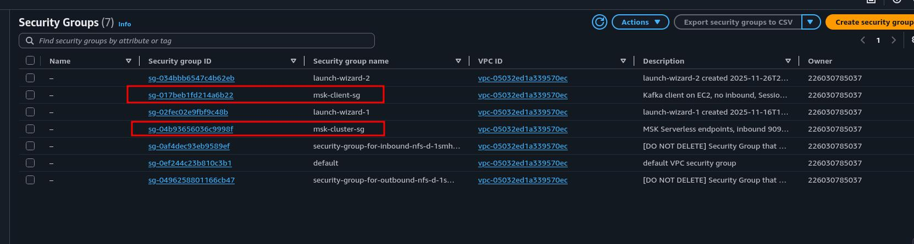

---

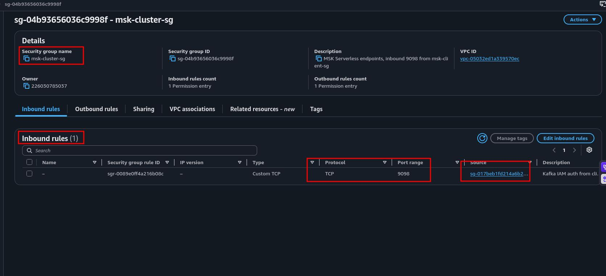

## 2. AWS IAM (EC2 Client Role and Kafka Permissions)

In this project the EC2 client will talk to two services: Systems Manager for the Session Manager connection, and the MSK cluster for Kafka traffic. Both are done through an **instance role** instead of access keys: the role attached to the instance provides temporary credentials through the instance metadata service, and the AWS CLI, the IAM plugin of the Kafka CLI and the Python library find these credentials on their own. The role has two parts: the **trust policy** (who may assume the role; here `ec2.amazonaws.com`) and the **permissions policy** (what the assumer may do).

We build the permissions side in two layers:

**The `AmazonSSMManagedInstanceCore` managed policy:** The permissions the SSM Agent inside the instance needs to register with Systems Manager and open a Session Manager session. Without this policy the instance runs, but the Session Manager tab on the console's Connect screen stays inactive.

**The `msk-client-kafka-policy` inline policy:** IAM access control in MSK works like this: every operation in Kafka's own authorization model (ACL) corresponds to an IAM action, and these actions are written with the `kafka-cluster:` prefix. When the client connects, the MSK IAM auth library signs the request with the instance role credentials using **SigV4**; the cluster verifies the identity with IAM and, on every Kafka request (creating a topic, writing a message, committing an offset), checks the corresponding `kafka-cluster` action against this policy. There is no username, password or certificate to distribute; revoking access is as easy as deleting a line from the role.

It is important to separate two IAM namespaces here: `kafka:` actions are the **control plane** (console operations such as creating or deleting a cluster or querying the bootstrap address), while `kafka-cluster:` actions are the **data plane** (operations performed inside the cluster with the Kafka protocol). We give the EC2 client data plane permissions only: it can write messages to the cluster and read them, but it cannot delete the cluster or create a new one.

The policy is written at three resource levels:

**Cluster:** `Connect` is the prerequisite of every other action; `DescribeCluster` is for reading the cluster metadata. `WriteDataIdempotently` comes from producers on Kafka 3.0 and later working **idempotently** by default: so that a message resent after a network error is not written to the topic twice, the producer obtains a producer ID from the cluster, and this request is authorized at the cluster level. Without this permission the producer may stop with a cluster authorization error.

**Topic:** Only `shipment-events`. `CreateTopic` (we will create it with the CLI in section 5), `DescribeTopic` and `DescribeTopicDynamicConfiguration` (reading the partition and configuration information), `WriteData` (producer) and `ReadData` (consumer).

**Group:** `AlterGroup` (joining a consumer group and committing offsets) and `DescribeGroup`. We give all groups in the cluster as the resource, because in sections 5 and 6 we will open several consumer groups with the CLI and with Python; in production this line is narrowed down per application to the group name (for example `ops-monitor`).

MSK resource ARNs follow this pattern: `arn:aws:kafka:<region>:<account-id>:<resource-type>/<cluster-name>/<cluster-uuid>/<resource-name>`. The cluster UUID is generated when the cluster is created and is not known yet; this is why we use `*` in its place. The cluster name, on the other hand, we fix right now: `shipment-cluster`.

### 2.1 Steps

First get your account number:

- In the console, click your account name at the top right.
- Copy the Account ID value; you will write it into the policy as 12 digits **without dashes**.

Create the role:

- Go to the IAM service in the console.
- Select Roles from the left menu.
- Click Create role.
- Select AWS service as the Trusted entity type.
- In the Use case section, select EC2 from the Service or use case dropdown; leave the EC2 option below it selected and click Next. (This choice writes the `ec2.amazonaws.com` principal into the trust policy, and the console creates an **instance profile** with the same name; this is the name we will see in the dropdown when attaching it to EC2 in section 4.)
- On the Permissions screen, type `AmazonSSMManagedInstanceCore` in the search box and check its checkbox.
- Click Next.
- Enter `msk-client-role` as the Role name.
- Click Create role.

Now let's add the Kafka permissions as an inline policy:

- Click `msk-client-role` in the Roles list.
- On the Permissions tab, select Create inline policy from the Add permissions dropdown.
- Select the JSON tab in the Policy editor.
- Paste the policy below (`<ACCOUNT_ID>` appears in three places; replace it with your own account number):

```json
{
  "Version": "2012-10-17",
  "Statement": [
    {
      "Sid": "ClusterAccess",
      "Effect": "Allow",
      "Action": [
        "kafka-cluster:Connect",
        "kafka-cluster:DescribeCluster",
        "kafka-cluster:WriteDataIdempotently"
      ],
      "Resource": "arn:aws:kafka:eu-central-1:<ACCOUNT_ID>:cluster/shipment-cluster/*"
    },
    {
      "Sid": "ShipmentEventsTopic",
      "Effect": "Allow",
      "Action": [
        "kafka-cluster:CreateTopic",
        "kafka-cluster:DescribeTopic",
        "kafka-cluster:DescribeTopicDynamicConfiguration",
        "kafka-cluster:WriteData",
        "kafka-cluster:ReadData"
      ],
      "Resource": "arn:aws:kafka:eu-central-1:<ACCOUNT_ID>:topic/shipment-cluster/*/shipment-events"
    },
    {
      "Sid": "ConsumerGroups",
      "Effect": "Allow",
      "Action": [
        "kafka-cluster:AlterGroup",
        "kafka-cluster:DescribeGroup"
      ],
      "Resource": "arn:aws:kafka:eu-central-1:<ACCOUNT_ID>:group/shipment-cluster/*"
    }
  ]
}
```

- Click Next.
- Enter `msk-client-kafka-policy` as the Policy name.
- Click Create policy.

**IMPORTANT:** This policy matches the cluster by name. If you do not create the cluster in section 3 with exactly the name `shipment-cluster`, the policy matches no resource and every Kafka operation fails with an authorization error; you see no error on the IAM side, the error only appears when the client connects. The topic name is fixed in the same way: there is no permission to write to or read from any topic other than `shipment-events`.

### 2.2 Verification

- Click `msk-client-role` in the Roles list; on the Trust relationships tab, see the `"Service": "ec2.amazonaws.com"` line.
- The Permissions tab should show two rows: one managed policy (`AmazonSSMManagedInstanceCore`, Type: AWS managed) and one inline policy (`msk-client-kafka-policy`, Type: Customer inline).
- Click `msk-client-kafka-policy` and check that your account number and the `shipment-cluster` name are written correctly in all three ARNs in the JSON, and that the `<ACCOUNT_ID>` expression remains nowhere.

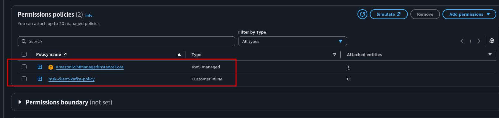

## 3. Amazon MSK Serverless (Cluster and Cluster Policy)

**Amazon MSK** (Managed Streaming for Apache Kafka) offers open source Apache Kafka as a service managed by AWS: the Kafka API is exactly the same, and existing producers, consumers and tools work without code changes. MSK has two cluster types:

**Provisioned:** You determine the number of brokers, the broker instance type (Standard or Express brokers) and the storage. Capacity planning, broker scaling and partition distribution are your responsibility; the cluster can take tens of minutes to come up. It is the most economical option for continuous and predictable high throughput.

**Serverless:** There is no concept of a broker. While creating the cluster you only provide a name and network information; capacity adjusts automatically to throughput and partitions are distributed in the background. The price is based on cluster hours, partition hours, the volume of data written and read, and storage. Authentication is done only with IAM access control, and data transfer is always encrypted with TLS.

There are three reasons we chose Serverless in this project: there is nobody on the team in the scenario to manage a cluster, the traffic is low and variable (planning capacity makes no sense), and the project is short (we need a cluster that is ready within minutes). There is also a technical reason: for Firehose to connect privately to the cluster, **multi VPC private connectivity** is required, and this feature does not support `kafka.t3.small`, the smallest provisioned broker type; in other words, the cheapest provisioned option is already ruled out in this architecture. A Serverless cluster offers the private connection through PrivateLink out of the box, with nothing extra to enable.

**Cluster policy:** The policy we wrote in section 2 was **identity based**: it defined what an identity (the EC2 role) can do. A cluster policy, on the other hand, is a **resource based** policy: it sits on the cluster and defines who can do what on this cluster. Firehose has no presence in our VPC; to read the cluster privately it opens a PrivateLink connection to the cluster from its own side, and it does this with the `kafka:CreateVpcConnection` API. The cluster policy grants the `firehose.amazonaws.com` service principal permission for this single call only. Firehose's permissions to read the topic (`kafka-cluster:ReadData` and so on) do not come from here but from its own role, which we will create in section 7. We add the policy now because it is a cluster setting, and if it is missing when the Firehose stream is created, the private connectivity option does not work.

**IMPORTANT:** The cluster is billed hourly from the moment it is created until it is deleted, even when idle. Finish the project without a break after this section; in the cleanup, this cluster is the resource deleted right after the Firehose stream.

### 3.1 Steps: Creating the Cluster

- Go to the Amazon MSK service in the console.
- Click Create cluster.
- Select **Custom create** as the Creation method. (Quick create creates the cluster with the default security group of the default VPC; we want to attach `msk-cluster-sg`.)
- Enter exactly `shipment-cluster` as the Cluster name.
- Select **Serverless** as the Cluster type.
- Click Next.

On the Networking screen:

- Select the default VPC (`172.31.0.0/16`) in the VPC field.
- In the Subnets section, select the subnet in `eu-central-1a` for the first zone and the subnet in `eu-central-1b` for the second zone. Open the third row with Add subnet and select the subnet in `eu-central-1c`. (MSK Serverless requires at least two subnets; providing all three AZs ensures that the client has a nearby endpoint whichever AZ it is in, and that it can switch to the others during an AZ outage.)
- In the Security groups field, remove the default security group that comes selected and select `msk-cluster-sg` instead.
- Click Next.

- On the Security screen, see that IAM role based authentication comes selected and click Next.
- Leave the defaults on the remaining screens (Metrics and Tags) and reach the Review screen:

- Check that Cluster type: Serverless, VPC: default VPC, the three subnets and `msk-cluster-sg` as the security group are shown.
- Click Create cluster.
- On the cluster page, wait for the Status to turn from **Creating** to **Active** (a few minutes).

Once the cluster is Active, get the connection information:

- In the Cluster summary section, click View client information. (This button stays inactive until the cluster is Active.)
- Copy and note the value under the **Endpoint** label. It has the form `boot-xxxxxxxx.c2.kafka-serverless.eu-central-1.amazonaws.com:9098` (the `c2` part in the middle may differ per cluster); this is the **bootstrap server** address that Kafka clients connect to first. The `9098` at the end is the port we opened in section 1.
- Also copy and note the **Cluster ARN** value in the Cluster summary section; we will use it in the next step.

### 3.2 Steps: Cluster Policy for Firehose

- On the `shipment-cluster` page, switch to the Properties tab.
- Scroll down to the Security settings section and click Edit cluster policy.
- On the Edit Cluster Policy screen, select the Advanced option that allows editing the policy JSON directly, not the ready template (Basic policy for multi VPC connectivity).
- Delete the content in the editor and paste the policy below (replace `<CLUSTER_ARN>` with the Cluster ARN you just copied):

```json
{
  "Version": "2012-10-17",
  "Statement": [
    {
      "Sid": "AllowFirehosePrivateConnection",
      "Effect": "Allow",
      "Principal": {
        "Service": "firehose.amazonaws.com"
      },
      "Action": "kafka:CreateVpcConnection",
      "Resource": "<CLUSTER_ARN>"
    }
  ]
}
```

- Click Save changes.

**NOTE:** The Cluster ARN has the form `arn:aws:kafka:eu-central-1:<account-id>:cluster/shipment-cluster/<uuid>`. We matched the UUID at the end with `*` in the policy of section 2; the `cluster/shipment-cluster/` part of the ARN must be exactly the same as in that policy.

### 3.3 Verification

- In the MSK console, in the Clusters list, see Cluster type **Serverless** and Status **Active** in the `shipment-cluster` row.
- On the cluster's Properties tab, in the Networking settings section, see the three subnets and only `msk-cluster-sg` as the security group.
- On the same tab, in the Security settings section, see that the access control method is IAM role based authentication.
- Check that you have noted the bootstrap endpoint (`...:9098`) and the Cluster ARN; in section 4 we will connect the EC2 client to this endpoint.

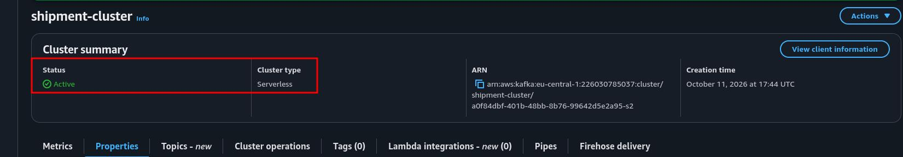

## 4. Amazon EC2 (Kafka Client Machine) and Session Manager

Because an MSK Serverless cluster has no endpoint open to the internet, the machine that will run the Kafka commands has to be inside the same VPC. The alternatives and why they were not chosen: the VPC environment of **AWS CloudShell** can also run from inside the VPC, but the session is temporary and the inside of the environment is not this transparent; writing the producer with **AWS Lambda** is possible, but packaging the Kafka libraries and attaching the function to the VPC pulls the focus of the project away from Kafka. EC2 is the simplest way to run both the Kafka CLI and the Python producer in the same place, and it is deleted when the work is done.

The reasons behind the choices made for the instance:

**Amazon Linux 2023:** The **SSM Agent** and **AWS CLI v2** come preinstalled; Java (Amazon Corretto) is in the default package repository.

**t3.small:** In sections 5 and 6 a producer and a consumer will run at the same time in two separate terminals; every Kafka CLI tool starts its own JVM. 2 GiB of memory comfortably carries two JVMs and Python; its hourly price is in the range of cents.

**No key pair:** We will connect to the instance with **Session Manager**. The SSM Agent inside the instance registers with Systems Manager over outbound HTTPS, and the terminal in the browser opens over this channel; there is no inbound port, there is no SSH key, access is controlled with IAM.

**The MSK IAM auth library:** The Kafka CLI does not recognize AWS IAM on its own. Kafka's authentication layer (SASL) works with a plugin logic; AWS's open source `aws-msk-iam-auth` library adds a new mechanism named `AWS_MSK_IAM` to this layer. The library finds the credentials with the AWS SDK's default chain (in our case the instance role), signs the connection request with **SigV4** and sends it to the cluster. The jar ending with `-all` also carries the AWS SDK dependencies inside; when placed in Kafka's `libs` folder it enters the classpath of the CLI tools on its own.

As the Kafka CLI version we use `3.9.2`, the latest release of the 3.x line; since Kafka clients are backward compatible, we do not need to know the version on the cluster side.

### 4.1 Steps: Creating the Instance

- Go to the EC2 service in the console.
- Click Launch instance.
- Enter `kafka-client` in the Name field.
- In the Application and OS Images section, verify that the **Amazon Linux 2023** AMI is selected (the default).
- Select `t3.small` as the Instance type.
- In the Key pair (login) field, select the **Proceed without a key pair (Not recommended)** option.
- In the Network settings section, click Edit.
- Verify that the default VPC is selected in the VPC field.
- Select the subnet in `eu-central-1a` as the Subnet. (Since we spread the cluster across all three AZs, it does not matter which one you choose.)
- Verify that the `Auto-assign public IP` field is **Enable**; it is required for the SSM Agent to reach Systems Manager and the package repositories.
- In the Firewall (security groups) section, check **Select existing security group** and select `msk-client-sg` from the dropdown.
- Leave the Configure storage section at its default (8 GiB gp3; more than enough for the Kafka archive and the Python packages).
- Expand the Advanced details section.
- Select `msk-client-role` from the IAM instance profile dropdown.
- Click Launch instance in the Summary panel on the right.
- Return to the Instances list and wait for the Instance state to be **Running** and the Status check to be **3/3 checks passed** (1 to 2 minutes).

### 4.2 Steps: Connecting with Session Manager

- In the Instances list, check the checkbox of the `kafka-client` row.
- Click Connect.
- Select the **Session Manager** tab.
- Click Connect. A terminal opens in a new browser tab.

If the Connect button is inactive: the instance has just started, and it takes a minute or two for the SSM Agent to register with Systems Manager; wait and refresh the page. If it is still inactive after waiting, check in order: is the IAM instance profile attached (Instance details → IAM Role), is a public IP assigned.

The Session Manager session opens with the `ssm-user` user. Run the following commands in the terminal:

```bash
# Switch to the standard user of Amazon Linux
sudo su - ec2-user

# Verify which identity the instance is running with
aws sts get-caller-identity
```

In the output, the `Arn` field should have the form `arn:aws:sts::<account-id>:assumed-role/msk-client-role/i-...`: the instance has assumed `msk-client-role` without any access key. This is the identity that will sign the Kafka connection.

### 4.3 Steps: Installing Java, the Kafka CLI and MSK IAM Auth

```bash
# Install Java 17 (Amazon Corretto)
sudo dnf install -y java-17-amazon-corretto-headless
java -version

# Download and extract the Kafka CLI
cd ~
curl -LO https://archive.apache.org/dist/kafka/3.9.2/kafka_2.13-3.9.2.tgz
tar -xzf kafka_2.13-3.9.2.tgz
mv kafka_2.13-3.9.2 kafka

# Download the MSK IAM auth library into Kafka's libs folder
cd ~/kafka/libs
curl -LO https://github.com/aws/aws-msk-iam-auth/releases/download/v2.3.7/aws-msk-iam-auth-2.3.7-all.jar
ls -lh aws-msk-iam-auth-2.3.7-all.jar
```

In the `ls` output the file size should be a few MB. If a file of a few KB came down, what was downloaded is not the jar but an error page; check the name of the current version's `-all.jar` file on the [`aws-msk-iam-auth` releases](https://github.com/aws/aws-msk-iam-auth/releases) page and repeat the command accordingly.

Now create the configuration file that tells the Kafka tools to connect with IAM:

```bash
cat > ~/kafka/config/client.properties << 'EOF'
security.protocol=SASL_SSL
sasl.mechanism=AWS_MSK_IAM
sasl.jaas.config=software.amazon.msk.auth.iam.IAMLoginModule required;
sasl.client.callback.handler.class=software.amazon.msk.auth.iam.IAMClientCallbackHandler
EOF
```

The meaning of the four lines: `SASL_SSL` says that the traffic will be encrypted with TLS and authentication will be done with SASL; `AWS_MSK_IAM` is the SASL mechanism to use; `IAMLoginModule` and `IAMClientCallbackHandler` are the classes of the library we just downloaded that find the credentials and sign the request.

Finally, make the bootstrap address and the path of the Kafka tools permanent (replace `<BOOTSTRAP_ENDPOINT>` with the Endpoint value you noted in section 3, including `:9098`):

```bash
echo 'export BOOTSTRAP="<BOOTSTRAP_ENDPOINT>"' >> ~/.bashrc
echo 'export PATH="$HOME/kafka/bin:$PATH"' >> ~/.bashrc
source ~/.bashrc
echo $BOOTSTRAP
```

### 4.4 Steps: Connection Test

First look at where the bootstrap address resolves:

```bash
getent hosts ${BOOTSTRAP%:*}
```

In the output you should see **private IPs** of the form `172.31.x.x`: these are the addresses of the VPC endpoints that MSK created in our subnets in section 3. The brokers run in AWS's environment, but the addresses the client sees are inside our VPC.

Now send a real Kafka request that authenticates with IAM:

```bash
kafka-broker-api-versions.sh \
  --bootstrap-server $BOOTSTRAP \
  --command-config ~/kafka/config/client.properties | grep "id:"
```

In the output you should see a series of lines, each containing `(id: ... rack: ...)` (in this project 15 brokers were listed). We do not manage brokers in Serverless, but the brokers have not disappeared; at the protocol level the client still talks to brokers, only their number, type and placement are AWS's responsibility.

**NOTE:** If the command waits for a while and fails with a **timeout**, the problem is in the network: check that the instance's security group is `msk-client-sg` and that the inbound rule of `msk-cluster-sg` has `msk-client-sg` as the source. If the error comes quickly with the words **authentication** or **authorization**, the problem is in IAM: check the account number and the `shipment-cluster` name in the policy of section 2.

### 4.5 Verification

- You saw the `assumed-role/msk-client-role` expression in the output of `aws sts get-caller-identity`.
- The output of `java -version` starts with `17`.
- The `getent hosts` output contains only private IPs in the `172.31.x.x` range.
- `kafka-broker-api-versions.sh` listed the broker lines: the network, TLS and IAM authentication all work.
- In the EC2 console, on the instance's Security tab, see `msk-client-sg` as the only security group and see that Inbound rules is empty: you reached both this terminal and the cluster without opening any inbound port.

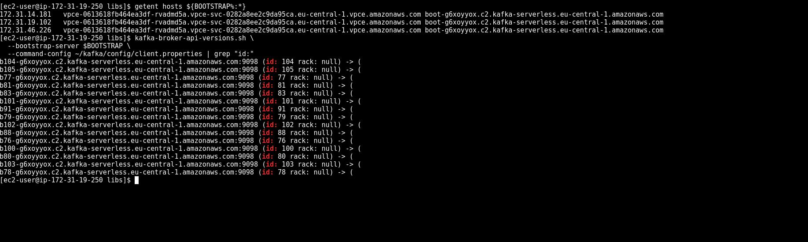

## 5. Kafka Topic and Producer/Consumer Test with the CLI

In Kafka, data is kept in **topics**; a topic is divided into one or more **partitions**. Each partition is an ordered log that is only appended to, and every message gets an increasing number within the partition: the **offset**. Three consequences of this structure are exactly what our scenario needs:

**Key and ordering:** When the producer sends a message with a **key**, the default partitioner hashes the key and computes its modulo by the number of partitions; the same key always lands in the same partition. Kafka guarantees ordering **within a partition**, not across the topic. When we make `shipment_id` the key, all events of a shipment sit in the same partition in the order they were produced; different shipments spread across partitions and are processed in parallel.

**Consumer group and offset:** Consumers read with a **group** name. The group **commits** to the cluster up to which offset it has read in which partition; when it stops and restarts, it continues where it left off. Different groups are completely independent of each other: the operations team's live monitoring and Firehose's archiving to S3 read the same data at their own pace, without affecting each other.

**Partition count:** The upper limit of the number of consumers that can run at the same time within a consumer group is the partition count. Since partitions are also billed hourly in Serverless, more than needed is cost; `3` is enough for this scenario. The partition count can be increased later but not decreased, and when it is increased, which partition the keys land in changes; in a system that relies on key based ordering this number is chosen with forethought.

We do not provide a replication factor: Serverless manages how many copies of the partitions are kept and how the copies are distributed across AZs.

In this section we will use two terminals: **Terminal 1** (the one you opened in section 4) for the producer, **Terminal 2** for the consumer.

### 5.1 Steps: Creating the Topic (Terminal 1)

```bash
kafka-topics.sh --bootstrap-server $BOOTSTRAP \
  --command-config ~/kafka/config/client.properties \
  --create --topic shipment-events --partitions 3
```

See the `Created topic shipment-events.` line in the output. Then look at the details of the topic:

```bash
kafka-topics.sh --bootstrap-server $BOOTSTRAP \
  --command-config ~/kafka/config/client.properties \
  --describe --topic shipment-events
```

You should see `PartitionCount: 3` in the first line and one line each for `Partition: 0`, `1` and `2` below it. The `Leader`, `Replicas` and `Isr` fields in each line show which brokers hold that partition; you created none of these brokers. The `ReplicationFactor: 3` and `min.insync.replicas=2` values in the first line are also Serverless's own choice: three copies of each partition are kept, and a write is not acknowledged until it reaches at least two copies. In section 6 the producer's `acks="all"` setting will wait for exactly this acknowledgement.

### 5.2 Steps: Starting the Consumer (Terminal 2)

- In the EC2 console, select the `kafka-client` instance, click Connect, and open a second session from the Session Manager tab.
- In the new terminal, switch to the standard user and start the consumer:

```bash
sudo su - ec2-user

kafka-console-consumer.sh --bootstrap-server $BOOTSTRAP \
  --consumer.config ~/kafka/config/client.properties \
  --topic shipment-events \
  --group ops-cli-test \
  --from-beginning \
  --property print.partition=true \
  --property print.offset=true \
  --property print.key=true
```

The consumer waits without output; this is normal, the topic is still empty.

### 5.3 Steps: Sending Messages with a Key (Terminal 1)

```bash
kafka-console-producer.sh --bootstrap-server $BOOTSTRAP \
  --producer.config ~/kafka/config/client.properties \
  --topic shipment-events \
  --property parse.key=true \
  --property "key.separator=|"
```

When the `>` prompt appears, paste the lines below. In each line, what comes before the `|` sign is the key and what comes after is the value:

```
SHP-1001|{"status":"created"}
SHP-1002|{"status":"created"}
SHP-1001|{"status":"picked_up"}
SHP-1003|{"status":"created"}
SHP-1001|{"status":"in_transit"}
SHP-1002|{"status":"picked_up"}
```

Switch to Terminal 2. For every message you should see a line consisting of the partition number, the offset, the key and the value. Pay attention to two things:

- All three events of `SHP-1001` sit in the **same partition**, with increasing offsets in that partition: the `created`, `picked_up`, `in_transit` order is preserved.
- Different keys may have spread across different partitions; the offsets of a partition start from 0 independently of the others.

Stop the producer and the consumer with `Ctrl+C` in both terminals.

### 5.4 Steps: Examining the Consumer Group and Offsets (Terminal 2)

Look at what the group committed to the cluster:

```bash
kafka-consumer-groups.sh --bootstrap-server $BOOTSTRAP \
  --command-config ~/kafka/config/client.properties \
  --describe --group ops-cli-test
```

The output shows a line saying that the group has no active members, and the `CURRENT-OFFSET`, `LOG-END-OFFSET` and `LAG` columns for every partition. `LAG` should be `0` in every partition: the group has read all messages and saved its position.

Now try reading again with the same group:

```bash
kafka-console-consumer.sh --bootstrap-server $BOOTSTRAP \
  --consumer.config ~/kafka/config/client.properties \
  --topic shipment-events \
  --group ops-cli-test \
  --from-beginning \
  --timeout-ms 15000
```

After 15 seconds the command ends with `Processed a total of 0 messages`. Nothing came even though we wrote `--from-beginning`, because this parameter applies only to a group that has no committed offset; `ops-cli-test` knows where it left off.

Run the same command with a new group name:

```bash
kafka-console-consumer.sh --bootstrap-server $BOOTSTRAP \
  --consumer.config ~/kafka/config/client.properties \
  --topic shipment-events \
  --group ops-cli-replay \
  --from-beginning \
  --timeout-ms 15000
```

This time all six messages come again and the command ends with `Processed a total of 6 messages`. Data is not deleted when it is read; it stays in the topic for the retention period, and every new consumer group can read it from the beginning. In section 7, Firehose will be added to the topic as exactly this kind of independent reader.

**NOTE:** If the producer fails with `ClusterAuthorizationException`, check that `kafka-cluster:WriteDataIdempotently` is in the cluster statement of the policy in section 2; the console producer works idempotently by default. If the consumer gives `GroupAuthorizationException`, check the `AlterGroup` and `DescribeGroup` permissions in the group statement.

### 5.5 Verification

- The `kafka-topics.sh --describe` output shows `PartitionCount: 3` for `shipment-events`.
- In the consumer output, the three events of `SHP-1001` appear in the same partition, with increasing offsets and in the order they were sent.
- In the `kafka-consumer-groups.sh --describe` output, the `LAG` value is `0` in all partitions for `ops-cli-test`.
- Reading again with the same group returned `0` messages, reading with a new group returned `6`.

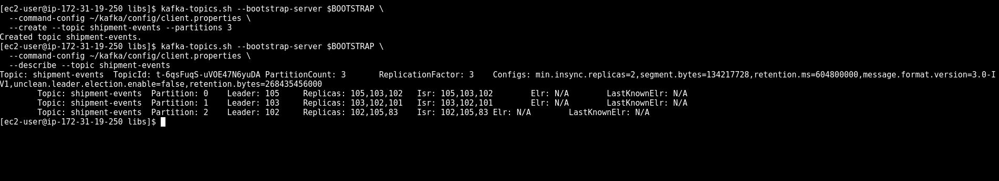

---

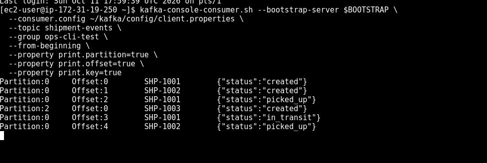

---

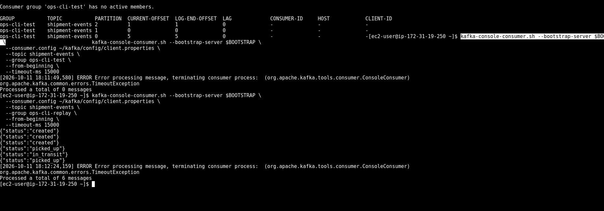

## 6. Python Producer and Live Monitoring (`ops-monitor`)

The CLI is good for testing, but in a real system an application produces the events. In this section we write a Python producer that produces the shipment events, and we watch the same topic live with the `ops-monitor` consumer group representing the operations team. The producer will run with Python, the consumer with the Java based Kafka CLI: the Kafka protocol is language independent, the two sides share only the topic and the message format.

**IAM authentication in Python:** In the Java clients we used the `AWS_MSK_IAM` SASL mechanism. Python clients instead use Kafka's standard **SASL/OAUTHBEARER** mechanism: AWS's `aws-msk-iam-sasl-signer-python` library generates a short lived **auth token** signed with SigV4 using the instance role credentials, and the Kafka client presents this token to the cluster as a bearer token. When the token expires, the client calls the token provider again. Since the identity is still `msk-client-role`, the policy of section 2 applies as it is; we write no separate permission for Python.

**Event model:** The key of every message is `shipment_id`, its value is a JSON object:

| Field | Description |
|---|---|
| `event_id` | Unique identifier of the event (UUID) |
| `shipment_id` | Shipment identifier; also the key of the message |
| `status` | `created`, `picked_up`, `in_transit`, `out_for_delivery`, `delivered` |
| `location` | Where the event took place: the origin city, a transfer hub or the destination city |
| `origin`, `destination` | The origin and destination city of the shipment |
| `event_time` | When the event took place (UTC, ISO 8601) |

For every shipment the script produces these statuses in order, with realistic hour gaps in between; about 20 percent of the shipments are not yet delivered and remain on the way (the "latest status" query in section 8 will show this). The event times spread over the last few days; the script sorts all events by time and writes them to the topic in that order. As a result, the events of different shipments interleave in the topic, but the events of each shipment flow in the order they were produced: this is exactly what the traffic landing in a topic looks like in a real operation.

**Synchronous sending:** After every message the script waits for the cluster's acknowledgement with `send(...).get()` and prints the partition and offset the message landed in. This is a deliberate choice to make the relationship between the key and the partition visible; in production, producers send messages asynchronously and increase throughput by collecting them in batches. `acks="all"` ensures that a message is acknowledged only after it is written to all copies.

**Live monitoring and offsets:** We will start the `ops-monitor` group without `--from-beginning`. A new group with no committed offset starts reading from the **end** of the topic by default: the operations team wants to see what is happening now, not the past. The "reading from the beginning" we saw with `ops-cli-replay` in section 5 is the need of the archive and audit side; the two work on the same topic without affecting each other.

The script is also available in the repository as `producer.py`.

### 6.1 Steps: Installing the Python Libraries (Terminal 1)

```bash
sudo dnf install -y python3-pip
pip3 install --user kafka-python aws-msk-iam-sasl-signer-python

# Verify the installation
python3 -c "import kafka, aws_msk_iam_sasl_signer; print(kafka.__version__)"
```

The version in the output should be `3.x` (`3.0.11` was used in this guide). `kafka-python` 3.0 differs from 2.x in two points that affect the script: the OAUTHBEARER token provider interface moved from `kafka.sasl` to `kafka.net.sasl`, and producers now work **idempotently** by default. The script tries the import for both versions; the `WriteDataIdempotently` permission required for idempotent sending is already in the policy of section 2.

### 6.2 Steps: producer.py

Write the script onto the instance:

```bash
cat > ~/producer.py << 'EOF'
"""
Kargo takip olay ureticisi (producer): Amazon MSK Serverless, IAM auth.

Her gonderi icin created -> picked_up -> in_transit -> out_for_delivery -> delivered
sirasiyla olay uretir ve shipment_id'yi key olarak kullanarak shipment-events
topic'ine yazar. Ayni key ayni partition'a dustugu icin bir gonderinin olaylari
sirasini korur.

Kullanim:
    export BOOTSTRAP="boot-xxxxxxxx.c1.kafka-serverless.eu-central-1.amazonaws.com:9098"
    python3 producer.py --shipments 30 --delay 0.2
"""
import argparse
import json
import os
import random
import socket
import time
import uuid
from collections import Counter
from datetime import datetime, timedelta, timezone

from aws_msk_iam_sasl_signer import MSKAuthTokenProvider
from kafka import KafkaProducer

# kafka-python 3.0 SASL modulunu kafka.net.sasl altina tasidi;
# script 2.x ve 3.x surumlerinin ikisiyle de calissin
try:
    from kafka.net.sasl.oauth import AbstractTokenProvider  # kafka-python 3.x
except ImportError:
    try:
        from kafka.sasl.oauth import AbstractTokenProvider  # kafka-python 2.1 - 2.3
    except ImportError:
        from kafka.oauth.abstract import AbstractTokenProvider  # kafka-python 2.0

REGION = os.environ.get("AWS_REGION", "eu-central-1")
TOPIC = "shipment-events"

STATUSES = ["created", "picked_up", "in_transit", "out_for_delivery", "delivered"]

# Bir onceki olaydan sonra gecen sure araligi (saat)
GAP_HOURS = {
    "picked_up": (1, 6),
    "in_transit": (4, 12),
    "out_for_delivery": (8, 20),
    "delivered": (1, 5),
}

CITIES = ["İstanbul", "Ankara", "İzmir", "Adana", "Bursa", "Antalya", "Konya", "Gaziantep"]
HUBS = ["Ankara Aktarma Merkezi", "İstanbul Aktarma Merkezi", "Konya Aktarma Merkezi"]


class MSKTokenProvider(AbstractTokenProvider):
    """Instance role credential'lari ile SigV4 imzali bir auth token uretir."""

    def token(self):
        token, _ = MSKAuthTokenProvider.generate_auth_token(REGION)
        return token


def build_shipment_events(shipment_id, now):
    origin, destination = random.sample(CITIES, 2)
    hub = random.choice(HUBS)
    location_by_status = {
        "created": origin,
        "picked_up": origin,
        "in_transit": hub,
        "out_for_delivery": destination,
        "delivered": destination,
    }

    # Gonderilerin yaklasik yuzde 20'si henuz teslim edilmemis, yolda kalmis olsun
    stage_count = len(STATUSES) if random.random() > 0.2 else random.randint(1, 4)

    event_time = now - timedelta(hours=random.uniform(48, 96))
    events = []
    for status in STATUSES[:stage_count]:
        if status != "created":
            low, high = GAP_HOURS[status]
            event_time += timedelta(hours=random.uniform(low, high))
        events.append({
            "event_id": str(uuid.uuid4()),
            "shipment_id": shipment_id,
            "status": status,
            "location": location_by_status[status],
            "origin": origin,
            "destination": destination,
            "event_time": event_time.strftime("%Y-%m-%dT%H:%M:%SZ"),
        })
    return events


def main():
    parser = argparse.ArgumentParser(description="Kargo takip olay ureticisi")
    parser.add_argument("--shipments", type=int, default=30, help="Uretilecek gonderi sayisi")
    parser.add_argument("--delay", type=float, default=0.2, help="Mesajlar arasi bekleme (saniye)")
    args = parser.parse_args()

    bootstrap = os.environ.get("BOOTSTRAP")
    if not bootstrap:
        raise SystemExit("BOOTSTRAP ortam degiskeni tanimli degil")

    producer = KafkaProducer(
        bootstrap_servers=bootstrap,
        security_protocol="SASL_SSL",
        sasl_mechanism="OAUTHBEARER",
        sasl_oauth_token_provider=MSKTokenProvider(),
        client_id=socket.gethostname(),
        acks="all",
    )

    now = datetime.now(timezone.utc)
    shipment_ids = [f"SHP-{n}" for n in random.sample(range(100000, 1000000), args.shipments)]

    events = []
    for shipment_id in shipment_ids:
        events.extend(build_shipment_events(shipment_id, now))

    # Butun olaylari zaman sirasina diz: gonderiler birbirine karisir,
    # ama her gonderinin kendi olaylari sirasini korur
    events.sort(key=lambda e: e["event_time"])

    partition_counts = Counter()
    for event in events:
        key = event["shipment_id"].encode("utf-8")
        value = json.dumps(event, ensure_ascii=False).encode("utf-8")
        # .get() gonderimi senkron yapar: partition ve offset'i ekrana basabilmek icin
        metadata = producer.send(TOPIC, key=key, value=value).get(timeout=30)
        partition_counts[metadata.partition] += 1
        print(f"{event['shipment_id']}  {event['status']:<17} -> partition {metadata.partition}, offset {metadata.offset}")
        time.sleep(args.delay)

    producer.flush()
    producer.close()

    delivered = sum(1 for e in events if e["status"] == "delivered")
    print()
    print(f"Toplam {len(events)} olay, {len(shipment_ids)} gonderi, {delivered} teslimat")
    for partition in sorted(partition_counts):
        print(f"  partition {partition}: {partition_counts[partition]} olay")


if __name__ == "__main__":
    main()
EOF

# Check the syntax
python3 -m py_compile ~/producer.py && echo OK
```

### 6.3 Steps: Starting Live Monitoring (Terminal 2)

```bash
kafka-console-consumer.sh --bootstrap-server $BOOTSTRAP \
  --consumer.config ~/kafka/config/client.properties \
  --topic shipment-events \
  --group ops-monitor \
  --property print.partition=true \
  --property print.key=true
```

The consumer waits without output. Since we did not give `--from-beginning`, it does not show the test messages of section 5; it will show only what comes from now on.

### 6.4 Steps: Running the Producer (Terminal 1)

```bash
python3 ~/producer.py --shipments 30 --delay 0.2
```

For about half a minute the script prints a line of the form `SHP-...  status -> partition N, offset M` for every event, and at the end it summarizes the total number of events and the partition distribution. Meanwhile look at Terminal 2: the same events land on the screen the moment they are produced.

When the producer finishes, pick the identifier of a shipment with a `delivered` line from the output of Terminal 1 (for example `SHP-229043`) and note it. Stop the consumer in Terminal 2 with `Ctrl+C`.

### 6.5 Steps: Ordering and Offset Check (Terminal 2)

Read all events of the shipment you picked from the topic from the beginning (replace `<SHIPMENT_ID>` with the identifier you noted):

```bash
kafka-console-consumer.sh --bootstrap-server $BOOTSTRAP \
  --consumer.config ~/kafka/config/client.properties \
  --topic shipment-events \
  --group ops-audit \
  --from-beginning \
  --timeout-ms 15000 \
  --property print.partition=true \
  --property print.offset=true | grep <SHIPMENT_ID>
```

You should see five lines: all in the **same partition**, with offsets in increasing order and `status` fields in the order `created`, `picked_up`, `in_transit`, `out_for_delivery`, `delivered`. The gaps between the offsets are the events of other shipments that landed in the same partition.

Finally look at the state of the `ops-monitor` group:

```bash
kafka-consumer-groups.sh --bootstrap-server $BOOTSTRAP \
  --command-config ~/kafka/config/client.properties \
  --describe --group ops-monitor
```

The `LAG` value should be `0` in all partitions: the live monitoring has read every event the producer wrote and saved its position.

**NOTE:** If the producer fails with `KafkaTimeoutError` before connecting (the counterpart of the old `NoBrokersAvailable` error in `kafka-python` 3.x), first check with `echo $BOOTSTRAP` that the address is defined. If you get an authorization error, verify with `aws sts get-caller-identity` that the instance is still running with `msk-client-role`; the Python client uses the same identity and the same policy as the Kafka CLI.

### 6.6 Verification

- `producer.py` finished its run with a summary line; the events are spread across three partitions.
- The `ops-monitor` consumer in Terminal 2 showed the events the moment they were produced and did not show the test messages of section 5.
- The five events of the selected shipment were read in the same partition, with increasing offsets and in the correct status order.
- In the `kafka-consumer-groups.sh --describe` output, the `LAG` value is `0` in all partitions for `ops-monitor`.

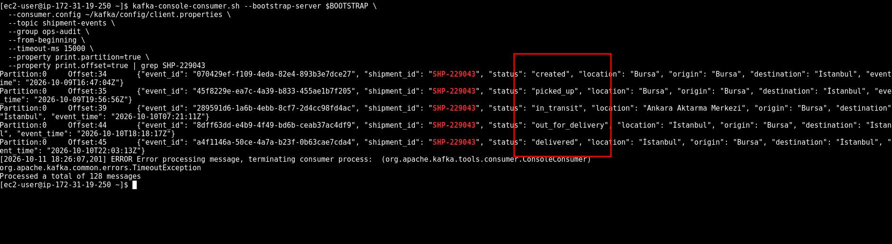

---

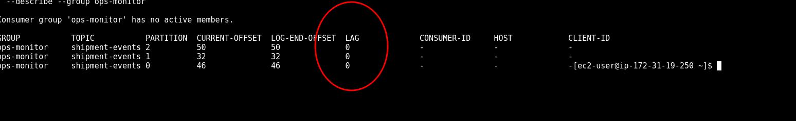

## 7. Amazon S3 and Amazon Data Firehose (From Kafka to the Data Lake)

At this point the events are flowing in Kafka and can be watched live. The second request of the scenario is for the same events to accumulate permanently in a **data lake** for analysis. A Kafka topic is not an archive: messages are deleted when the retention period expires, and they cannot be queried with SQL. We need a consumer that will carry the events to S3 as files.

**Amazon Data Firehose** is a fully managed delivery service that reads records from a source, buffers them and writes them to a destination as files. It recognizes MSK directly as a source: it reads the topic, accumulates the records until a size or time threshold, and writes them to S3 as a single file. There is no server, code or capacity setting; it scales by itself according to throughput, and the price is based on the volume of data processed.

**Why not MSK Connect + an S3 sink connector:** The classic solution of the Kafka world is Kafka Connect. Running it with MSK Connect requires finding the connector plugin (jar) and uploading it to S3, choosing worker capacity and writing the connector configuration; the workers are billed hourly for as long as they run. Firehose does the same job with a few clicks, without being billed when there is no data. Connect makes sense when a destination Firehose does not support or a complex transformation is needed.

**Why we do not write our own consumer:** An application on EC2 or Lambda that reads the topic and writes to S3 would also work. But batching, file size, retries on failure, tracking the read position and scaling remain the responsibility of that application. Firehose provides all of these as a service.

The reasons behind the choices made in the setup:

**Private connection:** Firehose installs nothing in our VPC. Thanks to the cluster policy we added in section 3, it opens a VPC connection to the cluster that is managed on its own side; `msk-cluster-sg` and `msk-client-sg` are never involved in this traffic.

**Topic starting position:** Where Firehose starts reading in the topic is determined with three options: **Firehose stream creation time** (the messages after the moment the stream is created), **Earliest** (from the oldest message in the topic) and **At timestamp** (from a given time). Had we selected Earliest, the six test messages we sent with the CLI in section 5, which have only a `status` field, would also have entered the data lake. This is why we select creation time and run the producer once more when the stream is ready.

**Buffer hints:** Firehose writes a file the moment either the buffer size or the buffer interval fills up, whichever comes first. To see the result quickly we use 1 MiB and 60 seconds. In production these values are increased (for example 64 MiB and 300 seconds): a small number of large files lowers both the S3 request cost and Athena's file opening overhead; small file inflation is the most common performance problem of data lakes.

**New line delimiter:** Firehose writes the records end to end. Without a delimiter, the JSON objects in a file sit side by side on a single line as `}{`, and Athena's JSON reader (which works line by line) cannot separate them. When we enable this setting, every record sits on its own line: the **JSON Lines** format.

**S3 prefix and folder structure:** The records are written under `raw/shipment-events/`; Firehose appends the `YYYY/MM/dd/HH/` folders after this prefix on its own. This date is not the event's `event_time` but the time the record **arrived** at Firehose (UTC). In analysis, time filters must always be done on `event_time`.

**IAM:** Firehose uses its own **service role** to read the source and write to the destination. The console creates this role automatically with the MSK read permissions (`kafka-cluster:Connect`, `DescribeTopic`, `ReadData`, `DescribeGroup` and `kafka:GetBootstrapBrokers` for obtaining the bootstrap address) and the S3 write permissions. The absence of `AlterGroup` in the role is notable: Firehose does not commit its read position to Kafka as a consumer group, it tracks it on its own side.

What is written to S3 is the **value** of every message. This is why we put `shipment_id` inside the value as well as in the key in the producer: on the data lake side, which shipment a record belongs to is known without looking at the key.

### 7.1 Steps: S3 Bucket

- Go to the S3 service in the console.
- Click Create bucket.
- Leave General purpose selected as the Bucket type.
- Enter `shipment-datalake-<suffix>` in the Bucket name field (replace `<suffix>` with a unique expression such as your name; bucket names are globally unique).
- Object Ownership: leave ACLs disabled (the default).
- Block Public Access settings: leave Block all public access checked.
- Bucket Versioning: leave Disable.
- Default encryption: leave the defaults (`SSE-S3`, Bucket Key Enable).
- Click Create bucket.
- Click the bucket and, on the Objects tab, create a folder named `athena-results` with Create folder. (In section 8 Athena will write its query results here. We do not create the `raw/` folder; Firehose will create it itself when writing the first file.)

### 7.2 Steps: Firehose Stream

- Go to the Amazon Data Firehose service in the console.
- Click Create Firehose stream.
- Select **Amazon MSK** as the Source and **Amazon S3** as the Destination.
- Enter `shipment-events-to-s3` in the Firehose stream name field.

In the Source settings section:

- Amazon MSK cluster connectivity: **Private bootstrap brokers** (this is the only option for a Serverless cluster).
- MSK cluster account: **Current account**.
- In the Amazon MSK cluster field, click Browse and select `shipment-cluster`.
- Enter `shipment-events` in the Topic field. (The topic cannot be changed after the stream is created.)
- Topic starting position: **Firehose stream creation time**.

Leave the Transform and convert records section at its default (off).

In the Destination settings section:

- In the S3 bucket field, click Browse and select `shipment-datalake-<suffix>`.
- New line delimiter: **Enabled**.
- Dynamic partitioning: leave Not enabled.
- Enter `raw/shipment-events/` in the S3 bucket prefix field (including the trailing `/`).
- Leave the S3 bucket error output prefix field empty.

Expand the Buffer hints, compression and encryption section:

- Buffer size: `1` MiB.
- Buffer interval: `60` seconds.
- Compression for data records: leave Not enabled. (In production GZIP is recommended; Athena reads compressed JSON directly. Here we do not compress so that we can open the files and inspect them by eye.)
- Leave the encryption settings at their default; the bucket's `SSE-S3` encryption applies.

In the Advanced settings section:

- Amazon CloudWatch error logging: leave Enabled; delivery errors are written here.
- Service access: leave **Create or update IAM role** selected (the console creates a role whose name starts with `KinesisFirehoseServiceRole-...`).
- Click Create Firehose stream.
- On the stream page, wait for the Status to be **Active**. Since Firehose establishes its private connection to the cluster during this time, it may take a few minutes.

### 7.3 Steps: Running the Producer Again (Terminal 1)

After the stream is Active:

```bash
python3 ~/producer.py --shipments 30 --delay 0.2
```

When the script finishes, wait one to two minutes: Firehose will fill its 60 second buffer interval and write the file.

**IMPORTANT:** The messages of a producer run before the stream was Active do not go to S3 because of the creation time option. The events we produced in section 6 remain in the topic but do not enter the data lake; Firehose reads only what comes after its own starting point.

### 7.4 Steps: Examining the Result in S3

- In the S3 console, enter the `shipment-datalake-<suffix>` bucket.
- Under `raw/shipment-events/`, open the year, month, day and hour folders down to the lowest folder; you should see one or more files whose names start with `shipment-events-to-s3-...` (in this project, three files totaling 27 KB were created for 125 events).
- Select a file and download it with Download; open it in a text editor. Each line should contain one event (`event_id`, `shipment_id`, `status`, `location`, `origin`, `destination`, `event_time`), and the lines should not be joined as `}{`.

### 7.5 Verification

- In the Firehose console, the Status of the `shipment-events-to-s3` stream is **Active**; the Source shows **Amazon MSK** (`shipment-cluster`, `shipment-events`) and the Destination shows **Amazon S3**.
- On the stream's Monitoring tab, within a few minutes after the producer ran, the `Records read from Amazon MSK` graph shows the number of events the producer wrote (125 in this project) and the `Delivery to Amazon S3 success` graph shows 100 percent. (The graphs fill with a delay of a few minutes.)
- In S3, there is at least one file under `raw/shipment-events/YYYY/MM/dd/HH/`, and every line in the file is a single JSON event.
- In the IAM console, the policy of the role whose name starts with `KinesisFirehoseServiceRole-...` shows the `kafka-cluster:ReadData` and `s3:PutObject` permissions.

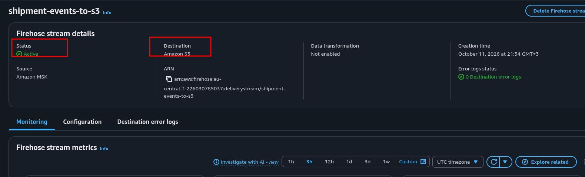

---

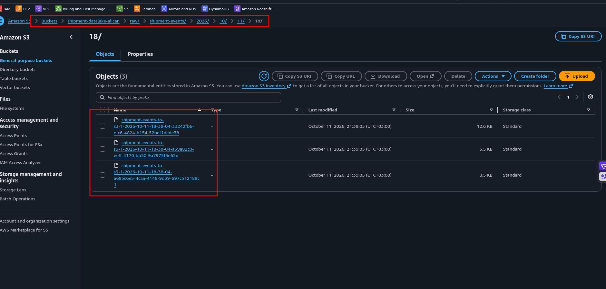

---

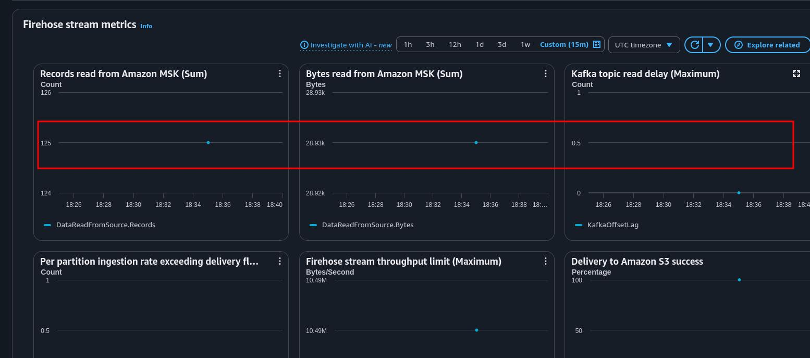

## 8. Amazon Athena (Querying on the Data Lake)

**Amazon Athena** is a serverless query service that queries the files in S3 in place with standard SQL. There is no infrastructure; the price is based on the volume of data the query scans. Athena works **schema on read**: the table definition does not touch the data itself, it is only a metadata record saying "read the files at this S3 path with these columns". This record is kept in the **AWS Glue Data Catalog**.

The reasons behind the choices made in the setup:

**DDL instead of a crawler:** We determined the schema ourselves while writing the producer; for a known schema a single `CREATE EXTERNAL TABLE` statement is both faster and more deterministic than a crawler. A crawler makes sense for sources whose schema is unknown or changes frequently.

**JSON SerDe and the time field:** Since the files are in JSON Lines format, we define the table with the **OpenX JSON SerDe**; the SerDe reads every line as a record and every JSON field as a column. We keep `event_time` as a `string` in the table and convert it to a time at query time with `from_iso8601_timestamp()`; ISO 8601 values with the `Z` suffix are parsed by this function without a problem.

**No partitions:** The `YYYY/MM/dd/HH/` folders Firehose writes are not Hive style (`year=2026/...`). A table without partitions reads all subfolders under `LOCATION`; for the data size of this project this is enough. When the data grows, this folder structure is introduced to the table with **partition projection** and queries scan only the folders of the relevant hours (we touch on this in section 9).

**Why not Redshift or OpenSearch:** The need of the analytics team is answering ad hoc questions on the accumulating archive. Redshift is strong for continuous and heavy BI load, OpenSearch for operational dashboards that update within seconds; both mean more infrastructure than this scenario needs.

The queries answer the two business questions of the scenario: **"Which shipments are still on the way?"** (operations) and **"How long does delivery take, and in which stage is the most time lost?"** (analytics).

### 8.1 Steps: Athena Settings

- Go to the Athena service in the console and open the Query editor.
- Switch to the Settings tab and click Manage.
- Enter `s3://shipment-datalake-<suffix>/athena-results/` in the Location of query result field (or select the `athena-results/` folder with Browse S3).
- Click Save and return to the Editor tab.

### 8.2 Steps: Database and External Table

Run the following query in the editor:

```sql
CREATE DATABASE shipment_db;
```

Select `shipment_db` from the Database dropdown in the left panel and create the table (replace `<suffix>` with your own bucket name):

```sql
CREATE EXTERNAL TABLE shipment_db.shipment_events (
  event_id     string,
  shipment_id  string,
  status       string,
  location     string,
  origin       string,
  destination  string,
  event_time   string
)
ROW FORMAT SERDE 'org.openx.data.jsonserde.JsonSerDe'
LOCATION 's3://shipment-datalake-<suffix>/raw/shipment-events/';
```

### 8.3 Steps: Queries

**1. Data check:** What arrived in the data lake?

```sql
SELECT COUNT(*)                    AS events,
       COUNT(DISTINCT event_id)    AS unique_events,
       COUNT(DISTINCT shipment_id) AS shipments
FROM shipment_db.shipment_events;
```

The `shipments` value should be **30** (in this project 125 events arrived for 30 shipments): because we started Firehose with stream creation time in section 7, only the shipments of the second producer run reached S3; the test messages of section 5 and the events of section 6 are not here. `events` and `unique_events` being equal shows that there are no duplicate records. Firehose delivers **at least once**; rarely, a record may be written twice, and in that case `event_id` is the key to filtering out the duplicates.

**2. Latest status:** Which shipments are still on the way?

```sql
WITH ranked AS (
  SELECT shipment_id,
         status,
         location,
         origin,
         destination,
         from_iso8601_timestamp(event_time) AS event_ts,
         ROW_NUMBER() OVER (
           PARTITION BY shipment_id
           ORDER BY from_iso8601_timestamp(event_time) DESC
         ) AS rn
  FROM shipment_db.shipment_events
)
SELECT shipment_id,
       status   AS current_status,
       location AS last_location,
       origin,
       destination,
       event_ts AS last_update
FROM ranked
WHERE rn = 1
  AND status <> 'delivered'
ORDER BY last_update;
```

`ROW_NUMBER()` numbers the events of every shipment in reverse time order; `rn = 1` is the latest event of the shipment. What remains in the result are only the shipments whose latest status is not `delivered`: the shipments the producer left on the way (11 of the 30 shipments in this run). For the operations team, this list is sorted so that "the shipment that has not moved for the longest time" is at the top.

**3. Stage durations:** Where is the most time lost?

```sql
WITH steps AS (
  SELECT shipment_id,
         status,
         from_iso8601_timestamp(event_time) AS event_ts,
         LAG(from_iso8601_timestamp(event_time)) OVER (
           PARTITION BY shipment_id
           ORDER BY from_iso8601_timestamp(event_time)
         ) AS previous_ts
  FROM shipment_db.shipment_events
)
SELECT status,
       COUNT(*) AS transitions,
       ROUND(AVG(date_diff('minute', previous_ts, event_ts)) / 60.0, 1) AS avg_hours_from_previous
FROM steps
WHERE previous_ts IS NOT NULL
GROUP BY status
ORDER BY avg_hours_from_previous DESC;
```

`LAG()` brings the time of the previous event of the same shipment next to every event; the difference is how long the transition to that stage took. The top row is the bottleneck: in this data set, the time from the transfer hub to going out for delivery (`out_for_delivery`, 13.3 hours on average); it is followed by transfer (`in_transit`, 7.0 hours), handover to the courier (`picked_up`, 4.0 hours) and from delivery round to delivery (`delivered`, 2.9 hours).

**4. End to end delivery time:**

```sql
WITH milestones AS (
  SELECT shipment_id,
         origin,
         destination,
         MIN(CASE WHEN status = 'created'   THEN from_iso8601_timestamp(event_time) END) AS created_at,
         MAX(CASE WHEN status = 'delivered' THEN from_iso8601_timestamp(event_time) END) AS delivered_at
  FROM shipment_db.shipment_events
  GROUP BY shipment_id, origin, destination
)
SELECT COUNT(*) AS delivered_shipments,
       ROUND(AVG(date_diff('minute', created_at, delivered_at)) / 60.0, 1) AS avg_hours,
       ROUND(MIN(date_diff('minute', created_at, delivered_at)) / 60.0, 1) AS min_hours,
       ROUND(MAX(date_diff('minute', created_at, delivered_at)) / 60.0, 1) AS max_hours
FROM milestones
WHERE delivered_at IS NOT NULL;
```

It collects the `created` and `delivered` times of every shipment into a single row and gives the average, shortest and longest delivery time of the delivered shipments in hours. In this project, for the 19 delivered shipments, the result was an average of 27.6 hours, a shortest of 18.2 hours and a longest of 32.3 hours.

### 8.4 Verification

- In the Glue console, under Data Catalog → Databases, see `shipment_db` and the `shipment_events` table inside it; the table's Location value points to the `raw/shipment-events/` prefix. We created the table with SQL, but the record is kept in the Glue Data Catalog.
- In query 1, the `shipments` value is `30` and `events` equals `unique_events`.
- Query 2 listed the shipments whose latest status is a value other than `delivered` (11 rows).
- Query 3 has four transition rows (`picked_up`, `in_transit`, `out_for_delivery`, `delivered`) and the highest average is in `out_for_delivery`.
- Query 4 returned the average, shortest and longest delivery time of the 19 delivered shipments.
- Query result files were created in the `athena-results/` folder.

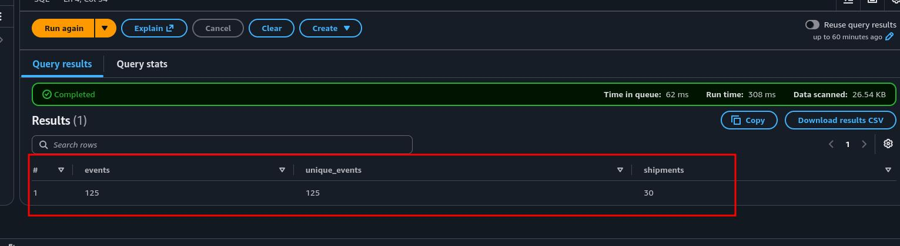

---

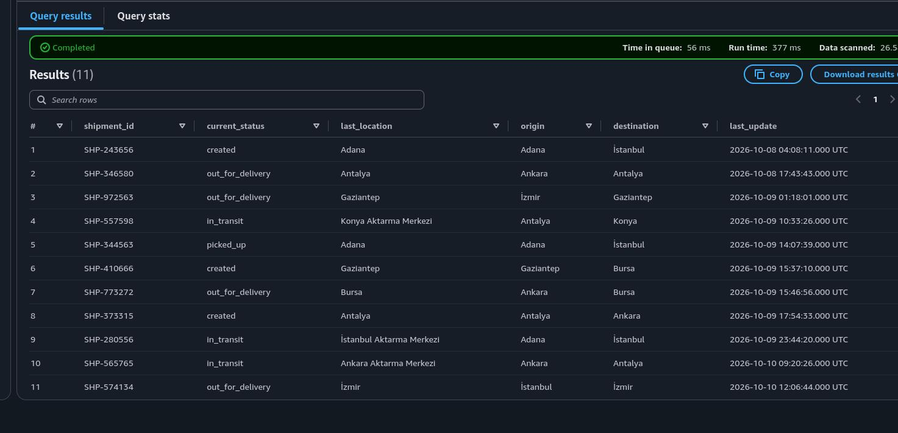

---

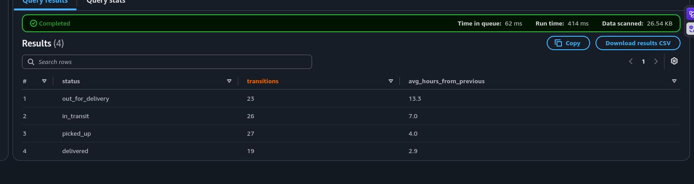

---

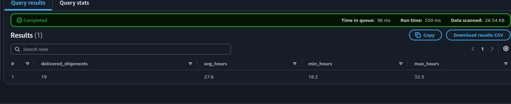

---

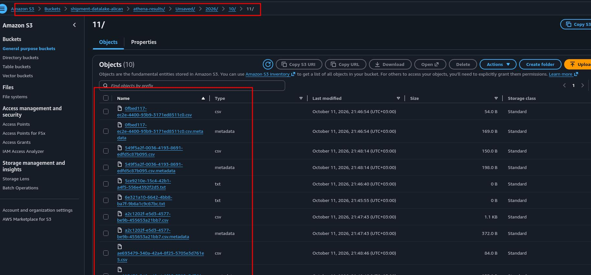

## 9. Evaluating the Architecture as a Whole

The flow we built: the Python producer writes events to the `shipment-events` topic on MSK Serverless with `shipment_id` as the key; the `ops-monitor` group watches the events the moment they are produced; Firehose reads the same topic and archives it to S3 as JSON Lines; Athena answers business questions on this archive with SQL. The guarantees each component adds to this picture:

**Decoupling of the producer and the consumers:** The producer knows no consumer; it only writes to the topic. In this project four independent readers read the same topic: `ops-cli-test`, `ops-cli-replay`, `ops-monitor` and Firehose. Each read at its own position and its own pace, and none affected the others. Adding a new team means opening a new consumer group without touching the producer.

**Ordering:** Kafka guarantees ordering within a partition, not across the topic. Because we made `shipment_id` the key, all events of a shipment sat in the same partition in the order they were produced (verified in 6.5); different shipments spread across three partitions and became processable in parallel. The price of this guarantee is thinking about the partition count up front: if the count is increased later, the mapping of keys to partitions changes.

**Delivery guarantees:** The producer worked with `acks="all"` and idempotent sending: a message is not acknowledged until it is written to all copies, and retries after a network error leave no duplicate records in the topic. Firehose, on the other hand, delivers at least once; on the data lake side, possible duplicates are filtered out with `event_id`. The end to end "exactly once" guarantee is a property of the design as a whole, not of a single component.

**Security layers:** At the network level the cluster has no endpoint open to the internet; no inbound port was opened on the client, and on the cluster port `9098` was opened only to resources carrying `msk-client-sg`. At the identity level no username, password or certificate was distributed; access was limited with IAM and data plane (`kafka-cluster:`) permissions, and the EC2 role can neither delete the cluster nor touch new topics. At the resource level the cluster policy gave the Firehose service only the permission to establish a private connection; the read permissions came from Firehose's own role.

**Cost model:** In Serverless, the cluster and the partitions are billed hourly even without traffic; Firehose is billed per data processed and Athena per data scanned. In low and fluctuating traffic this model frees you from capacity planning. In continuous and high throughput, a provisioned cluster (especially with Express brokers) becomes more economical; the decision is made according to the traffic profile.

What would be added when carrying this architecture to production:

- **Schema management:** The JSON contract between the producer and the consumers currently lives only in code. With the AWS Glue Schema Registry the schema is registered, and incompatible changes are rejected before they are even written to the topic.
- **Columnar format and partitions:** With Firehose's record format conversion feature, records are written to S3 as Parquet; Firehose's hour folders are introduced to Athena with partition projection, and queries scan only the relevant time range. Buffer values are increased and compression is enabled.
- **Network:** Producers run in applications in private subnets (ECS, Lambda) rather than on an EC2 instance in a public subnet; AWS services are reached through VPC endpoints.
- **Monitoring:** CloudWatch alarms are set up for the lag of the consumer groups; a continuously growing lag is the first sign that a consumer cannot keep up with production. The delivery errors Firehose writes to CloudWatch are also connected to alarms.
- **Narrower permissions:** Consumer group ARNs are narrowed down per application to the group name (such as `ops-monitor`); every application can read only with its own group.

## 10. Cleanup

The order was determined by cost and dependency. The only hourly billed resource is the MSK cluster; however, since Firehose is attached to the cluster with its own VPC connection, we delete the stream first and the cluster right after it. Security groups cannot be removed until the resources using them are completely deleted; this is why they come close to the end.

1. Firehose Stream

- In the Amazon Data Firehose console, select `shipment-events-to-s3`.
- Click Delete, type the stream name in the confirmation field and delete it. When the stream is deleted, the private connection it opened to the cluster is removed as well.

2. MSK Serverless Cluster

- In the MSK console, select `shipment-cluster` in the Clusters list.
- Select Delete from the Actions dropdown, type `delete` in the confirmation field and delete it.
- See that the Status is Deleting. The topics and all messages inside them are deleted together with the cluster; the VPC endpoints in the subnets are removed as well. The hourly charge stops with this step.

3. EC2 Instance

- In the EC2 console, select the `kafka-client` instance.
- Select Terminate (delete) instance from the Instance state dropdown and confirm. The root EBS volume is deleted together with the instance.

4. Athena

Run in order in the Query editor:

```sql
DROP TABLE shipment_db.shipment_events;
```

```sql
DROP DATABASE shipment_db;
```

These commands delete only the metadata in the Glue Data Catalog; they do not touch the files in S3.

5. S3 Bucket

- In the S3 console, select the `shipment-datalake-<suffix>` bucket.
- Click Empty, type `permanently delete` in the confirmation field and empty it.
- Select the bucket again, click Delete, type the bucket name in the confirmation field and delete it.

6. Security Groups

Wait until the cluster and the EC2 instance are completely deleted (the cluster no longer appears in the list and the instance state is Terminated); security groups cannot be deleted while they are in use.

- In the VPC console, open Security groups.
- First select `msk-cluster-sg` and delete it with Actions → Delete security groups. (The order matters because its inbound rule references `msk-client-sg`: the referencing one is deleted first.)
- Then delete `msk-client-sg` the same way.

7. IAM Roles

- In the IAM console, open Roles.
- Select `msk-client-role` and delete it with Delete (type the role name in the confirmation field). The console also deletes the instance profile carrying the same name as the role.
- Type `KinesisFirehoseServiceRole` in the search box; delete the role Firehose created in section 7 the same way.

8. CloudWatch Log Group

Firehose creates a log group for error logging, and this log group is not deleted automatically when the stream is deleted.

- In the CloudWatch console, open Log management from the left menu.
- Type `kinesisfirehose` in the search box, select the `/aws/kinesisfirehose/shipment-events-to-s3` log group and delete it with Actions → Delete log group(s).

Final check: verify that no resource belonging to this project remains in the MSK, Firehose, EC2 (Running instances), S3 and VPC security group lists. Checking in the Billing console the next day that the MSK line is no longer growing is the surest confirmation that no hourly billed resource was overlooked.

## 11. Result

At the end of this project, an end to end event streaming pipeline built without managing brokers is up and running in a personal AWS account, entirely through the console. An IAM protected **MSK Serverless** cluster was reachable only from inside the VPC, without a single port opened to the internet. The shipment events produced by the Python producer with `shipment_id` as the key spread across three partitions while preserving the order of every shipment. While a consumer group representing the operations team watched the same stream live, **Amazon Data Firehose** archived the events to S3 as JSON Lines without a single line of code. On this archive, **Athena** revealed with window functions, query by query, which shipments are still on the way, how long delivery takes end to end and in which stage the most time is lost.

The real gain of the project is that Kafka's core concepts (ordering with a partition key, independent reading with consumer groups, continuing where it left off and reading again with offsets) correspond directly to a business problem: the producer writes once, and every team consumes the data according to its own need, without waiting for each other. With the cleanup, no billed resource remained in the account.