# Public and Private Subnet Architecture with Amazon VPC: An Internet Facing Web Server and an Isolated Database
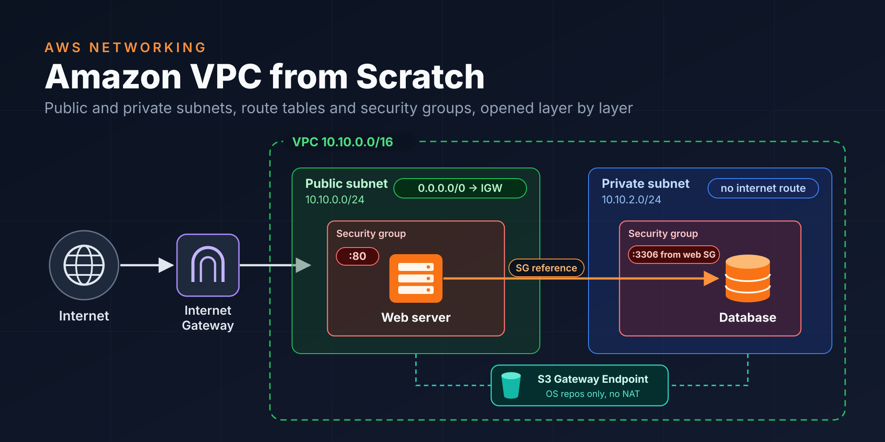

A network architecture project for a banking scenario, built from scratch entirely on the **AWS Console**. We build our own **VPC** in the `10.10.0.0/16` range. The internet facing web server sits in a public subnet, and the database, fully isolated from the internet, sits in a private subnet. We deliberately bring both servers up in a closed network. Then we open the traffic layer by layer: first the internet path with a **route table**, then port 80 with a **security group**, and finally the 3306 rule that allows only the web server. We see the effect of each layer in the browser. The database in the private subnet installs its packages through a free **S3 Gateway Endpoint**, without using a NAT Gateway. The project closes with a cleanup that leaves zero cost behind.

## What This Project Demonstrates

- The **VPC** and **subnet** concepts: CIDR planning, and a subnet being tied to a single Availability Zone
- That what makes a subnet public or private is not its name but the **route table** it is associated with
- Connecting a VPC to the internet with an **Internet Gateway**, and writing the `0.0.0.0/0` route only for the public subnet
- Installing operating system packages in a subnet with no internet access through an **S3 Gateway Endpoint** (without a NAT Gateway, at zero cost)
- Traffic control at the instance level with a **security group**: the stateful model and the default outbound behavior
- **Security group reference**: granting access by "identity" instead of IP; opening the DB only to the web server, and only on port `3306`
- A second line of defense at the application layer: limiting the database user so that it can connect only from the web subnet
- Verifying the effect of each network layer from the browser, without ever connecting to the servers

## Architecture

There are two subnets in the same Availability Zone inside the `10.10.0.0/16` VPC. The web server in the **public subnet** (`10.10.0.0/24`) has a public IP address; this subnet's route table sends internet bound traffic (`0.0.0.0/0`) to the Internet Gateway. The database server in the **private subnet** (`10.10.2.0/24`) has no public IP address, and its route table has no route to the internet either. A request coming from the internet passes through the Internet Gateway, reaches the web server's security group and gets in only through port `80`. The PHP page on the web server connects to the database's private IP address (`10.10.2.10`) on port `3306` over the `local` route inside the VPC. The database's security group opens this port only to resources carrying the web server's security group. The S3 Gateway Endpoint attached to both route tables lets both servers download their operating system packages from the Amazon Linux repositories without leaving for the internet.

## Services Used

`Amazon VPC` · `Internet Gateway` · `Route Tables` · `VPC Gateway Endpoint (Amazon S3)` · `Security Groups` · `Amazon EC2` · `Amazon Linux 2023` · `Apache` · `PHP` · `MariaDB`

## Prerequisites

- An AWS account. There is no NAT Gateway in the project, and the S3 Gateway Endpoint is free. The cost items are two `t3.micro` instances and the public IPv4 address of the web server; if the project is finished in a single session and cleaned up, the total cost is in the range of a few cents.
- Region: the guide uses `eu-central-1` (Frankfurt); any region works as long as it is used consistently.
- No tooling is needed on the local machine; we do not connect to the servers with SSH or Session Manager, and everything is verified from the browser.
- Familiarity with IP addresses and ports helps; the CIDR notation is explained in the relevant section.

## Problem (Solution Request)

The bank is renewing the front end of its internet banking with a new application. The application has two parts: a web server that customers reach from their browsers, and a database that holds account information. The security team's requests are clear: the web server must be reachable from the internet only over HTTP (`80`); the database must have no path to the internet at all, it must neither be reachable from outside nor be able to go out itself. The only resource allowed to connect to the database is the web server, and only on the MySQL port (`3306`). An additional constraint: the database server's operating system packages must be installable, but not by opening internet access to the server.

**Why we do not put the database in the public subnet as well and restrict it with a security group:** A security group blocks traffic as long as it is written correctly, but then it becomes the only line of defense. The moment a rule is opened to `0.0.0.0/0` by mistake, the database is exposed to the internet. In a private subnet, however, the database has no public IP address and no route to the internet, so even if the security group is written wrong, there is no path for a packet from the internet to reach it. The network layer (route table) and the instance layer (security group) work as two independent locks.

**Why not a NAT Gateway:** A NAT Gateway lets instances in a private subnet go out to the internet, and it is the classic solution for package installation. However, it is billed hourly and per data processed; more importantly, it gives the database the ability to "go out to the internet", which contradicts the "must not go out either" constraint in the request. Because the package repositories of Amazon Linux 2023 sit on Amazon S3, a free S3 Gateway Endpoint opens a private path for the database that leads only to these repositories; the rest of the internet stays closed.

**Why a security group as the source instead of an IP:** Writing the web server's IP into the DB rule breaks the rule when the server is recreated or a second web server is added. Giving the web server's security group as the source ties the rule to an identity rather than an IP: every instance carrying this security group is allowed automatically, and no resource without it can reach 3306.

**Why not a Network ACL:** A Network ACL is an additional, stateless layer that works at the subnet level; the ephemeral port range must also be opened separately for return traffic. The requirements in this scenario are fully met with route tables and security groups; the default NACL (which allows all traffic) stays as it is.

## Task List

1. Amazon VPC and subnets: the `10.10.0.0/16` VPC, a public (`10.10.0.0/24`) and a private (`10.10.2.0/24`) subnet
2. Internet Gateway and route tables: public and private route tables, with the IGW route deliberately left for later
3. S3 Gateway Endpoint: attached to both route tables, package installation without the internet
4. Security groups: `web-server-sg` and `db-server-sg`, both starting without inbound rules
5. Database server: private subnet, fixed IP `10.10.2.10`, MariaDB and a sample table with user data
6. Web server: public subnet, Apache, PHP and a test page that connects to the database with user data
7. Opening the traffic layer by layer: the IGW route, the `80` rule, the `3306` rule, and a browser test at every step
8. Evaluating the architecture as a whole
9. Cleanup (deleting the resources)

## 1. Amazon VPC (VPC and Subnets)

Amazon VPC is a logically isolated virtual network that belongs to you inside AWS; it works like a traditional data center network but runs on AWS infrastructure. When you create a VPC you give it an **IPv4 CIDR block**: the `10.10.0.0/16` notation means that the first 16 bits are fixed, that is, the roughly 65 thousand addresses between `10.10.0.0` and `10.10.255.255` belong to this network. The `10.0.0.0/8` range is a private address space; it is not routed on the internet, which is why every account can freely use the same range in its own VPC.

A **subnet** is a part carved out of the VPC's address range and tied to **a single Availability Zone**; resources such as EC2 are placed not in the VPC but in a subnet. A `/24` subnet contains 256 addresses; AWS reserves 5 addresses in every subnet for itself (the network address, the VPC router, DNS, future use and broadcast), so the number of usable addresses is 251. The web subnet will be `10.10.0.0/24` and the database subnet `10.10.2.0/24`; the `10.10.1.0/24` left empty in between is a deliberate gap that leaves room for adding a subnet for the same tier in a second AZ later.

There is a critical distinction here: what makes a subnet **public** or **private** is neither its name nor a setting chosen while creating it. Only the **route table** it is associated with decides this: if its route table has a route to an Internet Gateway it is public, otherwise it is private. In this section we create both subnets, but for now they are both in the same state: they have no path to the internet. We will create the difference with route tables in section 2.

We will make a single setting in the public subnet: **`Auto-assign public IPv4 address`**. While this setting is on, every instance placed in the subnet automatically receives a public IP. However, a public IP alone does not provide internet access; if there is no path to the IGW in the route table, requests coming to this IP never reach the instance. This is exactly what we will see in the first test of section 7.

**Why not the "VPC and more" wizard:** This option on the VPC creation screen builds the VPC, the subnets, the Internet Gateway, the route tables and an optional NAT Gateway in a single click. It is fast, but it hides what each piece does and how the pieces connect to each other. Since the purpose of this project is exactly to see those connections, we build each piece one by one with "VPC only".

**Why not the default VPC:** All subnets in the default VPC come public, and they are all associated with the main route table that carries the route to the IGW. A private subnet would require either changing this structure or building extra pieces next to it; starting with a clean VPC is both easier to understand and leaves the other resources in the account untouched.

When a VPC is created, AWS automatically creates three things in the background: a **main route table** (containing only the `local` route), a **default network ACL** (allowing all traffic) and a **default security group**. We will not use the main route table; in section 2 we will explicitly create and associate a route table of its own for each subnet. This way, it becomes visible at a glance which subnet is public and why, and which is private and why.

### 1.1 Steps: VPC

- In the console, verify at the top right that the region is **Frankfurt (`eu-central-1`)**.
- Go to the VPC service.
- Select Your VPCs from the left menu.
- Click Create VPC.
- Select **VPC only** in the Resources to create section.
- Enter `bank-vpc` in the Name tag field.
- In the IPv4 CIDR block section, leave IPv4 CIDR manual input selected; enter `10.10.0.0/16` in the IPv4 CIDR field.
- In the IPv6 CIDR block section, leave No IPv6 CIDR block selected.
- Leave the Tenancy field as Default.
- Click Create VPC.

### 1.2 Steps: Subnets

- Select Subnets from the left menu.
- Click Create subnet.
- Select `bank-vpc` in the VPC ID field.
- Fill in the first subnet in the Subnet settings section:
  - Subnet name: `public-web-subnet`
  - Availability Zone: `Europe (Frankfurt) / eu-central-1a`
  - IPv4 VPC CIDR block: `10.10.0.0/16` (filled in automatically)
  - IPv4 subnet CIDR block: `10.10.0.0/24`
- Click Add new subnet at the bottom of the page and fill in the second subnet:
  - Subnet name: `private-db-subnet`
  - Availability Zone: `Europe (Frankfurt) / eu-central-1a`
  - IPv4 subnet CIDR block: `10.10.2.0/24`
- Click Create subnet.

### 1.3 Steps: Automatic Public IP for the Public Subnet

- In the Subnets list, check the checkbox of `public-web-subnet`.
- Select Edit subnet settings from the Actions dropdown.
- In the `Auto-assign IP settings` section, check the **`Enable auto-assign public IPv4 address`** box.
- Click Save.

**NOTE:** We do not turn this setting on for `private-db-subnet`; the database server will never have a public IP address. It would also have been possible to turn this on per instance on the EC2 launch screen (`Auto-assign public IP`: Enable) instead of on the subnet; turning it on at the subnet level guarantees that every web server placed in this subnet gets the same behavior.

### 1.4 Verification

- In the Your VPCs list, see on the `bank-vpc` row that the IPv4 CIDR value is `10.10.0.0/16` and the State value is **Available**.
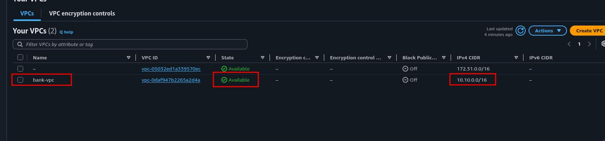
- Click `bank-vpc`; in the Details section, verify that the DNS resolution value is **Enabled** (required for the S3 Gateway Endpoint in section 3 to work; it comes enabled by default on new VPCs).
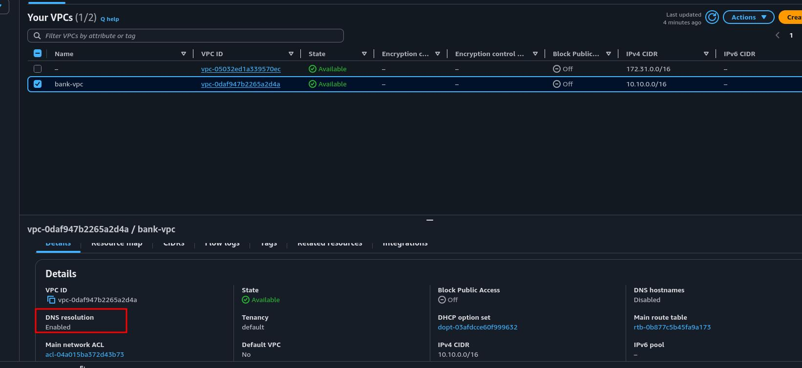
- In the Subnets list, look at the VPC column and see the two rows belonging to `bank-vpc`: `public-web-subnet` (`10.10.0.0/24`) and `private-db-subnet` (`10.10.2.0/24`), both in `eu-central-1a`.
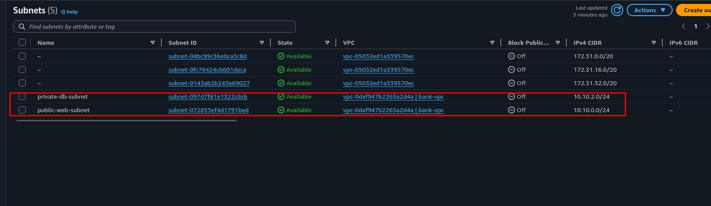
- Click `public-web-subnet`; in the Details section, verify that the `Auto-assign public IPv4 address` value is **Yes**, and that it is **No** for `private-db-subnet`.
- Switch to the Route table tab of `public-web-subnet`: see the main route table created automatically with the VPC, containing only the `10.10.0.0/16 → local` row. Right now both subnets are associated with this table, and neither of them has a path to the internet.

## 2. Internet Gateway and Route Tables

An **Internet Gateway (IGW)** is the gate between a VPC and the internet. It is managed by AWS as a horizontally scaled, redundant and highly available component; it has no bandwidth limit and no additional charge. Only one IGW can be attached to a VPC at a time. The IGW also has a second job: performing **1:1 NAT** for public IPv4 addresses. The instance's operating system sees only its own private IP (`10.10.0.x`); it is the IGW that translates a packet arriving at the public IP from the internet to the private IP, and a packet leaving the instance to the public IP.

However, attaching an IGW to a VPC changes nothing on its own. For traffic to go to the IGW, a **route table** must point to it. A route table is a list of rules that decides where traffic leaving a subnet is sent, based on the destination address. Every row has a **Destination** (the destination address range) and a **Target** (where the traffic is sent). If a packet matches more than one row, the most specific one, that is, the row with the longest prefix, wins (**longest prefix match**). Every route table contains a `10.10.0.0/16 → local` row that comes automatically and cannot be deleted. This row lets all subnets inside the VPC reach each other directly. The web server will connect to the database over this row.

Every subnet is associated with exactly one route table. Subnets that are not explicitly associated with a route table (no **explicit association**) automatically use the VPC's **main route table**. We will create a separate route table for each of the two subnets and associate them explicitly:

**`public-rt`:** Will be associated with `public-web-subnet`. The `0.0.0.0/0 → IGW` row that will make this subnet public will be written to this table. However, we will add this row not now but **in section 7**. We will first bring the servers up in a network with no path to the internet and see requests coming to the public IP fall into a timeout, then add the route and observe the difference.

**`private-rt`:** Will be associated with `private-db-subnet`. This table will never have a row going to the internet; in section 3, only the S3 Gateway Endpoint's route will be added.

**Why we do not use the main route table for the private subnet:** Technically the main route table would do the job, since it already contains only the `local` row. But the main route table is the table that every subnet without an explicit association uses silently. If someone later adds an IGW route to this table, every subnet without an explicit association becomes public without anyone noticing. Keeping the main route table minimal and consciously associating each subnet with its own table makes it clear and auditable which subnet is public and why.

**Why there is no NAT Gateway route:** The common setup in private subnets is a `0.0.0.0/0 → NAT Gateway` row. A NAT Gateway allows instances in a private subnet to go out to the internet but blocks connections coming from the internet. In this project we do not want the database to go out either; in section 3 we will open the only path needed for package installation with an S3 Gateway Endpoint, as a free line that leads only to the Amazon Linux repositories.

### 2.1 Steps: Internet Gateway

- In the VPC console, select Internet gateways from the left menu.
- Click Create internet gateway.
- Enter `bank-igw` in the Name tag field.
- Click Create internet gateway.
- The State value of the new IGW appears as **Detached**. Click Attach to a VPC in the green banner at the top of the page (if the banner has disappeared, select Attach to VPC from the Actions dropdown).
- Select `bank-vpc` in the Available VPCs field.
- Click Attach internet gateway.

### 2.2 Steps: `public-rt`

- Select Route tables from the left menu.
- Click Create route table.
- Enter `public-rt` in the Name field.
- Select `bank-vpc` in the VPC field.
- Click Create route table.
- On the `public-rt` details page that opens, switch to the Subnet associations tab.
- In the Explicit subnet associations section, click Edit subnet associations.
- Check the checkbox of `public-web-subnet`.
- Click Save associations.

### 2.3 Steps: `private-rt`

- On the Route tables page, click Create route table.
- Enter `private-rt` in the Name field.
- Select `bank-vpc` in the VPC field.
- Click Create route table.
- Switch to the Subnet associations tab.
- In the Explicit subnet associations section, click Edit subnet associations.
- Check the checkbox of `private-db-subnet`.
- Click Save associations.

**NOTE:** We do not click Edit routes on the Routes tab to add the IGW route. Right now `public-rt` is in the same state as `private-rt`: it has no path to the internet. The only difference between the two tables is that one of them will point to the IGW later.

### 2.4 Verification

- In the Internet gateways list, see on the `bank-igw` row that the State value is **Attached** and the VPC ID value is `bank-vpc`.
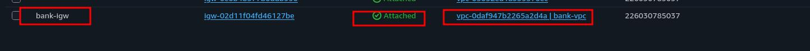
- In the Route tables list, look at the VPC column and see the three rows belonging to `bank-vpc`: the unnamed main route table whose Main column is **Yes**, `public-rt` and `private-rt`.
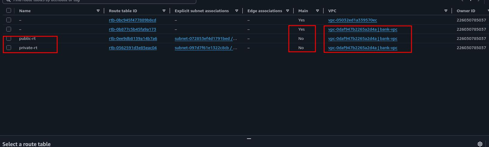
- Click `public-rt`; on the Routes tab, verify that there is a single row: `10.10.0.0/16 → local`. On the Subnet associations tab, see that `public-web-subnet` is explicitly associated.
- Do the same check for `private-rt`: a single row `10.10.0.0/16 → local`, and the associated subnet `private-db-subnet`.
- Click the main route table; on the Subnet associations tab, verify that the Explicit subnet associations section is empty and that no subnet remains in the Subnets without explicit associations section either.

## 3. VPC Gateway Endpoint (Amazon S3)

When the database server boots in section 5, it will install the MariaDB package; the web server will install the Apache and PHP packages in section 6. These packages come from the Amazon Linux 2023 repositories. These repositories sit on Amazon S3, in a separate bucket for each region; while downloading packages, `dnf` actually sends HTTPS requests to S3. Because the private subnet has no path to the internet, these requests would normally reach nowhere. The public subnet is in the same state right now: we left the IGW route for section 7.

A **VPC endpoint** lets resources inside a VPC reach an AWS service over the AWS network, without going out to the internet. There are two types:

**Gateway endpoint:** Exists only for Amazon S3 and DynamoDB, and is **free**. It does not create a resource in the network. To the route tables you select, it adds a row whose destination is a **prefix list** (`pl-...`) representing the IP ranges of S3 in that region, and whose target is the endpoint (`vpce-...`). Traffic going to S3 matches this row and goes through the endpoint.

**Interface endpoint:** Places an ENI with a private IP in the subnet (AWS PrivateLink). It supports many services, but it is billed both hourly and per data processed.

For S3, the gateway endpoint is clearly the right choice: it is free, its setup is a single screen, and the traffic never leaves for the internet. We will attach the endpoint to both route tables, so both servers will be able to install their packages without the internet. Because the prefix list row is more specific than `0.0.0.0/0` (longest prefix match), traffic from the public subnet to S3 will keep using this endpoint instead of the IGW even after we add the IGW route in section 7.

**Endpoint policy:** The default policy of a gateway endpoint is **Full access**: any S3 bucket in the account or on the internet can be reached through the endpoint. This means that if the database server is compromised, an attacker can send data to their own S3 bucket through this endpoint, even without being able to reach the internet. This is why we narrow the policy. Only the Amazon Linux 2023 repository bucket in this region will be readable through the endpoint, and the only allowed actions will be `s3:GetObject` and `s3:ListBucket`. An endpoint policy does not replace IAM policies; it draws an additional boundary on top of them. For a request to pass, both the requester's own permissions and the endpoint policy must allow it. Since the repository bucket is public, we do not need to give the instances an IAM role.

**NOTE:** This policy applies to all traffic passing through the endpoint. If an application in the public subnet needs to access another S3 bucket in the future, that bucket must also be added to the policy; otherwise the request is denied at the endpoint, even with the IGW route in place.

### 3.1 Steps

- In the VPC console, select Endpoints from the left menu.
- Click Create endpoint.
- Enter `s3-repo-endpoint` in the Name tag field.
- Select **AWS services** in the Type section.
- In the Services section, type `s3` in the search box and press Enter.
- In the list, select the row whose Service Name value is `com.amazonaws.eu-central-1.s3` and whose Type value is **Gateway**. (There is another row with the same name whose Type value is Interface; do not select it.)
- Select `bank-vpc` in the VPC field.
- In the Route tables section, check the checkboxes of `public-rt` and `private-rt`.
- Select **Custom** in the Policy section and paste the policy below:

```json
{
  "Version": "2012-10-17",
  "Statement": [
    {
      "Sid": "AmazonLinux2023RepoOnly",
      "Effect": "Allow",
      "Principal": "*",
      "Action": [
        "s3:GetObject",
        "s3:ListBucket"
      ],
      "Resource": [
        "arn:aws:s3:::al2023-repos-eu-central-1-de612dc2",
        "arn:aws:s3:::al2023-repos-eu-central-1-de612dc2/*"
      ]
    }
  ]
}
```

- Click Create endpoint.

**NOTE:** If you use a different region, replace the `eu-central-1` part in both ARNs with your own region; the `de612dc2` at the end of the bucket name is the same in all regions.

### 3.2 Verification

- In the Endpoints list, see on the `s3-repo-endpoint` row that the Endpoint type value is **Gateway** and the Status value is **Available**.
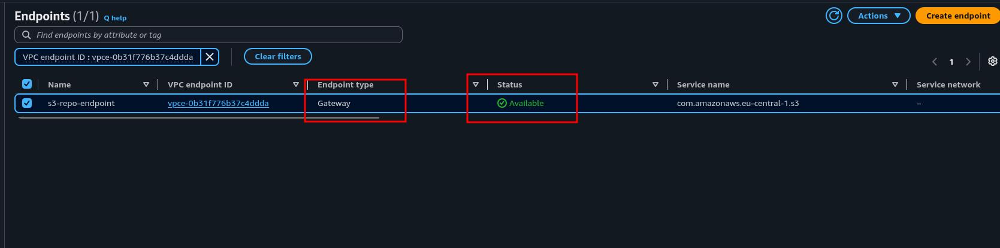
- Click `s3-repo-endpoint`; verify that `public-rt` and `private-rt` are listed on the Route tables tab, and that the policy you pasted appears on the Policy tab.
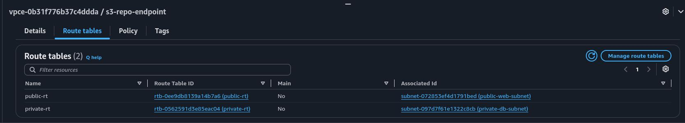
- Go back to the Route tables page and click `private-rt`. On the Routes tab, see that there are now two rows: `10.10.0.0/16 → local`, and a row whose Destination value is `pl-...` (`com.amazonaws.eu-central-1.s3`) and whose Target value is `vpce-...`.
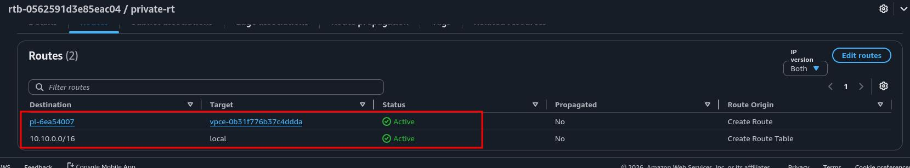
- See the same two rows in `public-rt` as well. Neither table has a `0.0.0.0/0` row yet: both subnets can reach the S3 repositories but cannot reach the internet.

## 4. Security Groups

A **security group** is a virtual firewall that works at the level of an instance's network interface (ENI). A route table decides which path traffic takes; a security group decides whether the traffic arriving on that path may enter the instance. In this project the two layers work independently: for a packet to reach the web server, the route table must give it a path and the security group must let it in.

Four properties determine the behavior of security groups:

**Allow rules only:** A "deny" rule cannot be written to a security group. All traffic that is not explicitly allowed is denied (**implicit deny**). This is why a security group with no inbound rules lets no traffic in.

**Stateful:** When a connection is allowed, the return traffic of that connection is allowed automatically. When the web server connects to the database, the database's response comes back regardless of the web server's inbound rules. A **Network ACL**, which works at the subnet level, is stateless; return traffic requires a separate rule.

**Default outbound:** Every newly created security group comes with an `All traffic → 0.0.0.0/0` rule on the outbound side. Every connection the instance initiates can go out. Whether the outgoing traffic actually reaches anywhere is decided by the route table.

**Tied to a VPC:** A security group can be attached only to instances in the VPC it was created in.

We will create two security groups, and both will start with **empty** inbound rules. We will add the rules one by one in section 7, as we see the effect of each in the browser:

**`web-server-sg`:** For the web server. In section 7 it will receive a single inbound rule: `80/TCP`, source `0.0.0.0/0`. Bank customers must be able to connect from anywhere.

**`db-server-sg`:** For the database server. In section 7 it will receive a single inbound rule: `3306/TCP`, with `web-server-sg` itself as the source instead of an IP range (**security group reference**).

On both sides we leave the outbound rule as it is. For the web server to connect to the database on `3306`, we do not need to open anything on the outbound side, because the default rule already allows everything. The database's outbound rule also allows everything in theory, but since `private-rt` has no row to the internet, the only places this traffic can go are the inside of the VPC and the S3 repository endpoint.

**Why we do not touch the outbound side:** A common setup writes outbound rules allowing only ports 80, 443 and 3306, and then adds `All traffic` on top of them. This step is unnecessary, because a new security group is already born with this behavior. In production, narrowing the outbound side is good practice; for example, limiting the database's outbound to `443/TCP` toward the S3 prefix list only. Since the main lesson in this project is inbound control, we keep the default.

### 4.1 Steps: `web-server-sg`

- In the VPC console, select Security groups from the left menu.
- Click Create security group.
- Enter `web-server-sg` in the Security group name field.
- Enter `Web server in public subnet, HTTP from internet` in the Description field.
- In the VPC field, remove the default VPC that comes selected by default and select **`bank-vpc`**.
- Leave the Inbound rules section **empty**.
- In the Outbound rules section, leave the default rule (All traffic, `0.0.0.0/0`) as it is.
- Click Create security group.

### 4.2 Steps: `db-server-sg`

- On the Security groups page, click Create security group.
- Enter `db-server-sg` in the Security group name field.
- Enter `DB server in private subnet, MySQL from web-server-sg only` in the Description field.
- Select **`bank-vpc`** in the VPC field.
- Leave the Inbound rules section **empty**.
- Leave the Outbound rules section at its default.
- Click Create security group.

**NOTE:** The VPC field comes filled with the default VPC every time; if `bank-vpc` is not selected here, the security group is created in the wrong VPC and does not appear on the EC2 launch screen in sections 5 and 6. Description fields accept ASCII characters only; if non ASCII characters are typed, the security group is not created.

### 4.3 Verification

- In the Security groups list, look at the VPC ID column and see that `web-server-sg` and `db-server-sg` are under `bank-vpc`. The security group named `default`, created automatically with the VPC, is also listed in the same VPC; we will not use it.
- Click `web-server-sg`; verify that the Inbound rules tab is empty and that the Outbound rules tab has a single row: All traffic, `0.0.0.0/0`.
- Do the same check for `db-server-sg`.
- Note the IDs of the two security groups (`sg-...`); we will use `db-server-sg` in section 5 and `web-server-sg` in section 6.

## 5. Amazon EC2 (Database Server)

We launch the database server before the web server. In section 6, the test page on the web server will connect to this server's address; the database it connects to must be ready at that point.

The server will be placed in `private-db-subnet` and **will have no public IP address**. Instead of leaving the private IP address to be assigned randomly by AWS, we fix it: `10.10.2.10`. The web server's code will use this address directly. In production, a DNS name is preferred over a fixed IP; for example, a Route 53 private hosted zone record or the endpoint given by Amazon RDS. Since the goal of this project is to see the network layer, we choose the simplest path.

We use **MariaDB** as the database engine. MariaDB is an open source fork of MySQL; it uses the same protocol and the same default port (`3306`), and MySQL clients talk to it directly. It is available in the Amazon Linux 2023 repository as the `mariadb105-server` package. The server will download this package at boot through the S3 endpoint we built in section 3.

We do the entire installation with **user data**. User data is a script that is run once by `cloud-init` with root privileges when the instance first boots. The script does the following:

- Installs MariaDB and configures it to listen for connections coming from other machines (`bind-address=0.0.0.0`).
- Creates the `bankdb` database and a sample `accounts` table, and inserts three fictional customer records into the table.
- Creates the `webapp` user for the web application.

We limit this user in two ways. First, the user can connect only from `10.10.0.%` addresses, that is, only from the web subnet. Second, it has only read (`SELECT`) permission. This is **a second line of defense at the application layer**, independent of the security group. Even when we open port `3306` in section 7, it will not be possible to connect with this user from outside the web subnet.

**Why not Amazon RDS:** In production, a managed database (Amazon RDS or Aurora) is almost always the right choice: backups, patching and failover become the responsibility of AWS. However, RDS requires a DB subnet group with subnets in two different Availability Zones, and it does not show the inside of the server. The topic of this project is not database management but the network path leading to it. A database on EC2 shows the effect of route tables and security groups in exactly the same way.

### 5.1 Steps

- Go to the EC2 service in the console.
- Select Instances from the left menu and click Launch instances.
- Enter `db-server` in the Name field.
- In the Application and OS Images section, select **Amazon Linux** on the Quick Start tab; **Amazon Linux 2023 AMI** should be selected in the Amazon Machine Image field, and the Architecture field should stay at **`64-bit (x86)`**.
- Select `t3.micro` in the Instance type field.
- In the Key pair field, select **Proceed without a key pair (Not recommended)**. Since we will never connect to the server, we do not need a key.
- In the Network settings section, click Edit and fill in the fields:
  - VPC: `bank-vpc`
  - Subnet: `private-db-subnet`
  - `Auto-assign public IP`: **Disable** (it should already come as Disable because of the subnet setting; check it)
  - Firewall (security groups): **Select existing security group**; select `db-server-sg` from the Common security groups list
- In the same section, expand Advanced network configuration; enter `10.10.2.10` in the Primary IP field.
- Leave the Configure storage section at its default (8 GiB, gp3).
- Expand the Advanced details section; paste the script below into the User data field at the very bottom:

```bash
#!/bin/bash
set -ex

# MariaDB server installation (packages come through the S3 gateway endpoint)
dnf install -y mariadb105-server

# Listen on all interfaces so the web server can connect
cat > /etc/my.cnf.d/bank.cnf <<'EOF'
[mysqld]
bind-address=0.0.0.0
EOF

systemctl enable --now mariadb

# Database, sample table and an app user limited to the web subnet
mariadb <<'SQL'
CREATE DATABASE bankdb;
USE bankdb;
CREATE TABLE accounts (
  id INT PRIMARY KEY AUTO_INCREMENT,
  customer VARCHAR(50),
  iban VARCHAR(34),
  balance DECIMAL(12,2)
);
INSERT INTO accounts (customer, iban, balance) VALUES
  ('Ayse Demir',   'TR000000000000000000000001', 15250.00),
  ('Mehmet Kaya',  'TR000000000000000000000002',  4780.50),
  ('Zeynep Arslan','TR000000000000000000000003', 98300.75);
CREATE USER 'webapp'@'10.10.0.%' IDENTIFIED BY 'BankDemo2026!';
GRANT SELECT ON bankdb.* TO 'webapp'@'10.10.0.%';
FLUSH PRIVILEGES;
SQL

echo "DB_SETUP_COMPLETE"
```

- In the Summary panel on the right, check that the Number of instances value is `1` and click Launch instance.

**NOTE:** The password in the script is for this demo only. User data can be read from the console by anyone with permission to view the instance; in production, passwords are kept in a service such as AWS Secrets Manager, and the application reads them at runtime.

### 5.2 Verification

- In the Instances list, see on the `db-server` row that the Instance state value is **Running** and that within a few minutes the Status check column shows all checks passing (**checks passed**).
- Click `db-server`; on the Details tab, verify that the **Public IPv4 address** field is empty and that the **Private IPv4 addresses** field is `10.10.2.10`.
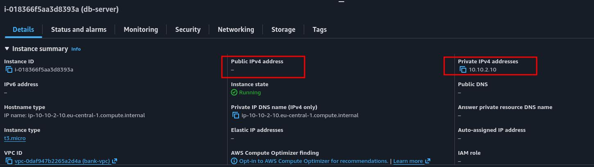
- See on the Networking tab that the Subnet ID is `private-db-subnet`, and on the Security tab that the security group is `db-server-sg`.
- Let's check that the installation succeeded without connecting to the server: with `db-server` selected, select **Monitor and troubleshoot** → **Get system log** from the Actions dropdown. In the output, look for the `dnf` package download lines and, at the very end, the `DB_SETUP_COMPLETE` line (you can use Ctrl+F on the page). This line shows that a server with no path to the internet at all installed its packages through the S3 endpoint and that the database is ready.
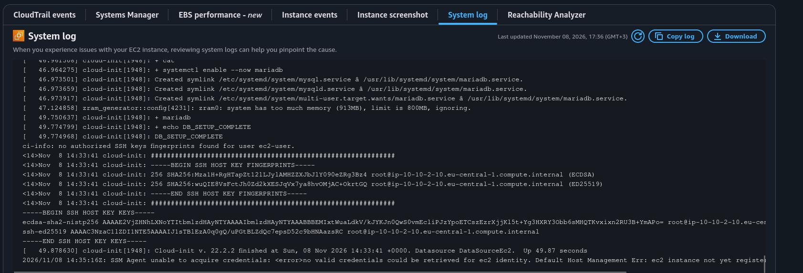

**NOTE:** The system log may appear empty for a few minutes after the instance boots; if it is empty, wait 2 to 3 minutes and open it again. If instead of `DB_SETUP_COMPLETE` you see timeout or `Curl error` lines related to `dnf`, check that the endpoint from section 3 is attached to `private-rt` and check the region name in the endpoint policy. The `SSM Agent unable to acquire credentials` line that appears at the end of the log is expected: we did not give the instances an IAM role and we do not use Session Manager; it does not affect the installation.

## 6. Amazon EC2 (Web Server and Test Page)

The web server will be placed in `public-web-subnet`. Thanks to the `Auto-assign public IPv4` setting we turned on in section 1, it will automatically receive a public IP. But since `public-rt` does not have the IGW route yet, this IP is not reachable from the internet right now. The server itself cannot go out to the internet either; like the database server, it will install the Apache and PHP packages through the S3 endpoint.

**Apache** (`httpd`) and **PHP** will run on the server. On Amazon Linux 2023, PHP comes as **`PHP-FPM`**: Apache forwards incoming `.php` requests to the `PHP-FPM` service. We also install the `php-mysqli` extension to connect to the database.

The user data script writes a small test page to `/var/www/html/index.php`. Every time the page is opened, it does the following:

- Shows the server's own private IP. The operating system does not know the public IP; that translation is done by the IGW.
- Tries to connect to `10.10.2.10:3306` with the `webapp` user.
- If the connection succeeds, it lists the `accounts` table. If it fails, it writes the error message on the screen.

We gave the connection attempt a **3 second** timeout. When a security group rejects a packet, it does not send a "rejected" answer to the other side; it drops the packet silently. The client, in turn, waits on a connection that gets no answer until the timeout expires. With the default timeouts the page would hang for a long time; after 3 seconds we will see a clear "Connection timed out" message. This message will be the evidence of the state before we add a rule to `db-server-sg` in section 7.

### 6.1 Steps

- In the EC2 console, click Launch instances on the Instances page.
- Enter `web-server` in the Name field.
- In the Application and OS Images section, **Amazon Linux 2023 AMI** and **`64-bit (x86)`** should be selected.
- Select `t3.micro` in the Instance type field.
- In the Key pair field, select **Proceed without a key pair (Not recommended)**.
- In the Network settings section, click Edit and fill in the fields:
  - VPC: `bank-vpc`
  - Subnet: `public-web-subnet`
  - `Auto-assign public IP`: **Enable** (it should come as Enable because of the subnet setting; check it)
  - Firewall (security groups): **Select existing security group**; select `web-server-sg` from the list
- Leave the Configure storage section at its default.
- Expand the Advanced details section; paste the script below into the User data field:

```bash
#!/bin/bash
set -ex

# Apache, PHP and the MySQL extension (packages come through the S3 gateway endpoint)
dnf install -y httpd php php-mysqli

# Test page: connects to the DB server and lists the accounts table
cat > /var/www/html/index.php <<'EOF'
<?php
mysqli_report(MYSQLI_REPORT_OFF);
$db = mysqli_init();
$db->options(MYSQLI_OPT_CONNECT_TIMEOUT, 3);
$ok = @$db->real_connect('10.10.2.10', 'webapp', 'BankDemo2026!', 'bankdb', 3306);
?>
<!DOCTYPE html>
<html>
<head><meta charset="utf-8"><title>Bank Web Server</title>
<style>
body { font-family: sans-serif; margin: 40px; }
table { border-collapse: collapse; }
td, th { border: 1px solid #999; padding: 6px 12px; }
.ok { color: green; } .fail { color: red; }
</style></head>
<body>
<h1>Bank Web Server</h1>
<p>Web server private IP: <b><?= $_SERVER['SERVER_ADDR'] ?></b></p>
<h2>Database connection (10.10.2.10:3306)</h2>
<?php if ($ok): ?>
  <p class="ok"><b>CONNECTED</b></p>
  <table>
    <tr><th>ID</th><th>Customer</th><th>IBAN</th><th>Balance</th></tr>
    <?php foreach ($db->query('SELECT * FROM accounts') as $r): ?>
      <tr><td><?= $r['id'] ?></td><td><?= $r['customer'] ?></td><td><?= $r['iban'] ?></td><td><?= $r['balance'] ?></td></tr>
    <?php endforeach; ?>
  </table>
<?php else: ?>
  <p class="fail"><b>FAILED:</b> <?= htmlspecialchars(mysqli_connect_error()) ?></p>
<?php endif; ?>
</body>
</html>
EOF

systemctl enable --now php-fpm httpd

echo "WEB_SETUP_COMPLETE"
```

- Click Launch instance.

### 6.2 Verification

- In the Instances list, see on the `web-server` row that the Instance state value is **Running** and that the Status check column shows **checks passed**.
- Click `web-server`; on the Details tab, verify that there is an IP in the **Public IPv4 address** field and an address in the form `10.10.0.x` in the **Private IPv4 addresses** field. Note the public IP; we will open this address in the browser in section 7.
- With `web-server` selected, select **Monitor and troubleshoot** → **Get system log** from the Actions dropdown. In the output, see that the `httpd`, `php` and `php-mysqli` packages were installed and, at the very end, the `WEB_SETUP_COMPLETE` line. The installation succeeded despite there being no IGW route: the packages came through the S3 endpoint.
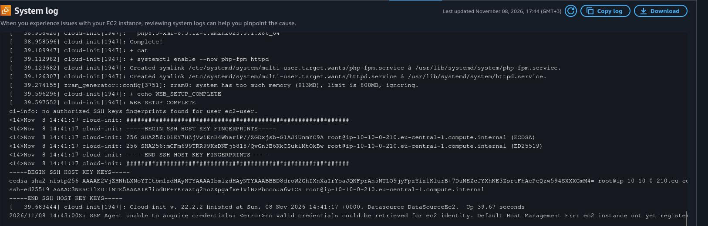

**NOTE:** Do not open the public IP in the browser yet. The next section starts with exactly this test, and its purpose is to see why no answer comes back at this stage.

## 7. Opening the Traffic Layer by Layer

The infrastructure is ready but deliberately closed: `public-rt` has no route to the internet, and neither security group has an inbound rule. In this section we will change a single layer each time and test from the browser. Every link of the chain stretching from the internet to the database will become visible one by one.

Before the tests, let's write the chain out once from start to finish. A customer's request passes along this path to reach the web server: Internet → Internet Gateway → the `0.0.0.0/0` row of `public-rt` → the `80` rule of `web-server-sg` → Apache. The request going from the web server to the database passes along this path: the `local` row of `public-rt` → the `3306` rule of `db-server-sg` → MariaDB → the host restriction of the `webapp` user. When one of the links is missing, the chain breaks.

The point to pay attention to is this: whether the route is missing or the security group rule is missing, the symptom the client sees is the same: **timeout**. Both layers drop the packet silently and send no "rejected" answer. Looking from the client side, it is impossible to tell which layer is the problem. This is why network problems are checked layer by layer, from the outermost inward; this is exactly what we do in this section.

### 7.1 Test 1: No Route, No Rule

- In the EC2 console, click `web-server` and copy the **Public IPv4 address** value.
- In a new browser tab, type `http://<PUBLIC_IP>` in the address bar and press Enter. Make sure to type the `http://` part at the beginning.

**Expected result:** The page tries to load for a while and finally gives an **ERR_CONNECTION_TIMED_OUT** error (or, depending on your browser, "This site can't be reached" / "The connection has timed out").

**Why:** The request comes to the public IP but cannot get inside the VPC. Because `public-rt` has no row going to the internet, the IGW does not carry traffic to this subnet. The instance having a public IP is not enough on its own.

**NOTE:** Some browsers automatically convert the address to `https://`. Since the server listens for HTTP only on port `80`, this conversion leads to a confusing timeout in the later tests as well. If you see `https://` in the address bar, correct it manually to `http://`.

### 7.2 Adding the Internet Gateway Route

- In the VPC console, select Route tables from the left menu and click `public-rt`.
- On the Routes tab, click Edit routes.
- Click Add route.
- In the Destination field, type or select `0.0.0.0/0`.
- In the Target field, select **Internet Gateway**; in the box that opens below it, select `bank-igw` (`igw-...`).
- Click Save changes.

With this row, `public-web-subnet` has become **public** in the true sense. We do not touch `private-rt`; `private-db-subnet` stays private.

### 7.3 Test 2: Route Present, No Rule

- Refresh the `http://<PUBLIC_IP>` address in the browser tab.

**Expected result:** **Timeout** again.

**Why:** The path is now open; the packet passes through the IGW and reaches the web server's network interface. But because `web-server-sg` has no inbound rule, the security group drops the packet at the door. The symptom is the same as in the first test, the cause is different.

### 7.4 HTTP Permission for the Web Server

- In the VPC console, select Security groups from the left menu and click `web-server-sg`.
- On the Inbound rules tab, click Edit inbound rules.
- Click Add rule.
- Select **HTTP** in the Type field (Protocol `TCP` and Port range `80` are filled in automatically).
- Select **`Anywhere-IPv4`** in the Source field (`0.0.0.0/0`).
- Enter `HTTP from internet` in the Description field.
- Click Save rules.

### 7.5 Test 3: Web Server Open, Database Closed

- Refresh the `http://<PUBLIC_IP>` address in the browser tab.

**Expected result:** The page opens after waiting about 3 seconds. At the top you see the **Bank Web Server** heading and the web server's private IP (`10.10.0.x`). In the Database connection section, **FAILED** appears in red, followed by an error message indicating a timeout (`Connection timed out`).
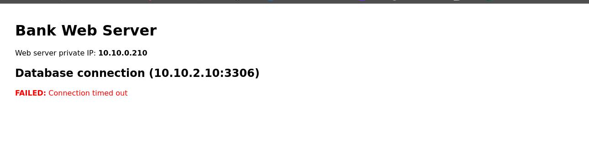

**Why:** The chain stretching from the internet to the web server is complete. Notice that the IP shown on the page is `10.10.0.x`, not the public IP: the operating system knows only its private IP, and the public IP translation is done by the IGW. The path from the web server to the database exists as well: the `local` row in `public-rt` connects the two subnets. However, because `db-server-sg` has no inbound rule, the packet arriving at `3306` is dropped. PHP waits 3 seconds for an answer and gives up.

### 7.6 Access to the Database Only from the Web Server

The connection is established from the web server toward the database; the traffic is **arriving** at the database. This is why the place to edit is the **inbound** rules of `db-server-sg`. We do not need to do anything on the web server side: the outbound side of `web-server-sg` is already open, and because security groups are stateful, the database's response will come back automatically.

As the source, we give `web-server-sg` itself instead of an IP or the `10.10.0.0/24` range. You can think of it as an instruction given to a security guard at the door: instead of "let in whoever comes from this IP", it is "anyone carrying the `web-server-sg` identity may enter through door `3306`". Even if the web server is recreated and its IP changes, or ten more web servers are added next to it, the rule keeps working as long as they carry the same security group. An instance placed in the same subnet but not carrying this security group, on the other hand, cannot reach the database.

- On the Security groups page, click `db-server-sg`.
- On the Inbound rules tab, click Edit inbound rules.
- Click Add rule.
- Select **MYSQL/Aurora** in the Type field (Protocol `TCP` and Port range `3306` are filled in automatically).
- Leave **Custom** selected in the Source field; type `web-server` in the search box next to it and select `web-server-sg` (`sg-...`) from the list that appears.
- Enter `MySQL from web-server-sg only` in the Description field.
- Click Save rules.

### 7.7 Test 4: End to End Connection

- Refresh the `http://<PUBLIC_IP>` address in the browser tab.

**Expected result:** The page opens without waiting. In the Database connection section, **CONNECTED** appears in green, and the three fictional customer records in the `accounts` table are listed below it.
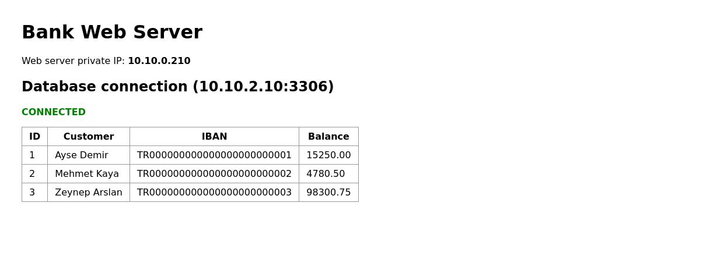

**Why:** All the links of the chain are in place. Moreover, the database's response reached the web server even though `web-server-sg` has no inbound rule at all for `3306`; this is the concrete proof that security groups are stateful.

### 7.8 Verification

- Verify that there are three rows on the Routes tab of `public-rt`: `10.10.0.0/16 → local`, `pl-... → vpce-...` and `0.0.0.0/0 → igw-...`.
- Verify that the Routes tab of `private-rt` still has only two rows: `local` and `pl-...`. There is no `0.0.0.0/0` row, and the database has no path to the internet.
- See that the Inbound rules tab of `web-server-sg` has a single row: HTTP, `80`, `0.0.0.0/0`.
- See that the Inbound rules tab of `db-server-sg` has a single row: MYSQL/Aurora, `3306`, and the ID of `web-server-sg` (`sg-...`) as the Source value. The source is not an IP range but a security group.
- In the EC2 console, verify that the Public IPv4 address field of `db-server` is still empty. There is neither an address nor a path to connect to the database from the internet; the only resource that can reach it is the web server carrying `web-server-sg`.

## 8. Evaluating the Architecture as a Whole

In the structure we built, a request from the internet passes through the Internet Gateway, enters the public subnet through the `0.0.0.0/0` row of `public-rt`, and reaches the web server through the `80` rule of `web-server-sg`. The web server connects to the database in the private subnet on port `3306`, over the `local` route inside the VPC and through the security group reference rule of `db-server-sg`. The database has neither a public IP nor a route to the internet; its only door to the outside world is the S3 endpoint, which can read only the Amazon Linux repositories. The guarantee each component adds to this picture:

**Network layer (route table):** The first lock, deciding whether a resource can talk to the internet. What makes a subnet public or private is not its name but a single row in its route table. In the tests from 7.1 to 7.3 we saw that, until this row was added, even a server with a public IP could not be reached. On the database side this lock was never opened. Even if the security group is opened to `0.0.0.0/0` by mistake, there is no path to carry a packet from the internet to the database.

**Instance layer (security group):** The second lock, deciding which traffic gets in even when the path is open. The web server opens only port `80`. The database opens only port `3306`, and only to resources carrying `web-server-sg`. Thanks to the security group reference, the rule is tied to an identity rather than to IPs. When the web tier scales out or instances are replaced, the rule keeps working without change. Thanks to the stateful model, no separate rule had to be written for return traffic.

**Application layer (database user):** The `webapp` user can connect only from `10.10.0.%` addresses and has only read permission. Even if the network rules are loosened one day, it is not possible to connect with this user from outside the web subnet.

**Endpoint policy:** The S3 Gateway Endpoint made package installation possible without opening the internet to the database. The narrowed policy, in turn, prevents this path from turning into a data exfiltration channel: through the endpoint, only the Amazon Linux 2023 repository bucket can be read, and no other bucket can be written to.

**Cost model:** The VPC, the subnets, the route tables, the Internet Gateway, the security groups and the S3 Gateway Endpoint are free. The only billed items are the two `t3.micro` instances and the web server's public IPv4 address. Both the hourly and the per data charges of the NAT Gateway, the classic solution, disappeared entirely with the endpoint.

What would be added when carrying this architecture to production:

- **High availability:** Right now everything is in a single Availability Zone. In production, a subnet is opened in a second AZ for each tier; ranges such as `10.10.1.0/24`, which we left empty in section 1, are for this. The database is moved to Amazon RDS or Aurora running `Multi-AZ`.
- **Load balancer and a private web tier:** An Application Load Balancer is placed in the public subnets. The web servers are moved into private subnets and lose their public IPs. The load balancer becomes the only component that talks to the internet directly. The web servers' security group opens port `80` only to the load balancer's security group instead of `0.0.0.0/0`; this is the referencing logic of 7.6 applied one tier up.
- **HTTPS:** Serving a banking application over plain HTTP is unacceptable. A `443` listener is added to the load balancer with a certificate from AWS Certificate Manager, and requests arriving on `80` are redirected to `443`.
- **Secrets management:** The database password is removed from the user data and the application code, and kept in AWS Secrets Manager.
- **Observability:** In section 7 we saw that both a missing route and a missing security group rule appear on the client as the same timeout. When **VPC Flow Logs** are enabled, dropped packets appear with a `REJECT` record, together with the interface and the port where they were rejected. Network problems are worked on with evidence instead of guesses.
- **Administrative access:** When the servers need to be accessed for maintenance, the SSH port is not opened. Session Manager is used, and the interface endpoints needed for the servers in the private subnet are added.

## 9. Cleanup (Deleting the Resources)

The order was determined by cost and dependency. Since the only billed items are the EC2 instances and the public IPv4 address, they are deleted first. A VPC cannot be deleted while an instance or a network interface is still running inside it; this is why it comes last.

1. EC2 Instances

- On the Instances page of the EC2 console, check the checkboxes of `web-server` and `db-server`.
- Select **Terminate (delete) instance** from the Instance state dropdown and confirm.
- Wait until the Instance state value of both instances is **Terminated**. The root EBS volumes are deleted together with the instances, and the web server's public IPv4 address is released as well. The charges stop with this step.

2. S3 Gateway Endpoint

- In the VPC console, select Endpoints from the left menu.
- Select `s3-repo-endpoint`; select **Delete VPC endpoints** from the Actions dropdown, type `delete` in the confirmation field and delete it. The `pl-...` rows the endpoint added to the two route tables are removed as well.

3. VPC

- Select Your VPCs from the left menu and select `bank-vpc`.
- Select **Delete VPC** from the Actions dropdown.
- In the window that opens, see the list of resources that will be deleted together with the VPC: the two subnets, `public-rt` and `private-rt`, `bank-igw`, `web-server-sg` and `db-server-sg`. The console first detaches the Internet Gateway from the VPC and then deletes it; it also resolves the reference between the security groups itself.
- Type `delete` in the confirmation field and click Delete.

**NOTE:** If the Delete VPC step gives an error saying that resources are still in use, wait a minute or two for the instances to reach the Terminated state and for their network interfaces to be released, then try again.

Final check: verify that no instance belonging to this project remains in the Running state in the EC2 Instances list, that only the default VPC remains in the Your VPCs list, and that the Endpoints list is empty.

## 10. Result

At the end of this project, a two tier network architecture built from scratch, entirely through the console, is up and running in a personal AWS account. In our own VPC in the `10.10.0.0/16` range, the web server in the public subnet became reachable from the internet only on port `80`. The database in the private subnet had no connection to the internet at all; the only resource that could reach it was the web server carrying the `web-server-sg` identity, and only on port `3306`. The database was installed without ever going out to the internet, through a free **S3 Gateway Endpoint** that allows only the Amazon Linux repositories. Throughout the project no server was ever connected to; the result of every step was verified from the browser and the console.

The real gain of the project was seeing concretely that network security is made up of independent layers. When we started the traffic in a deliberately closed network and opened it layer by layer, the effect of each link became visible one by one: the **route table** decided the path, the **security group** the door, and the database user the application's own boundary. A missing layer always showed up on the client with the same symptom, as a timeout. This showed why network problems must be checked from the outside in, layer by layer. With the cleanup, no billed resource remained in the account.